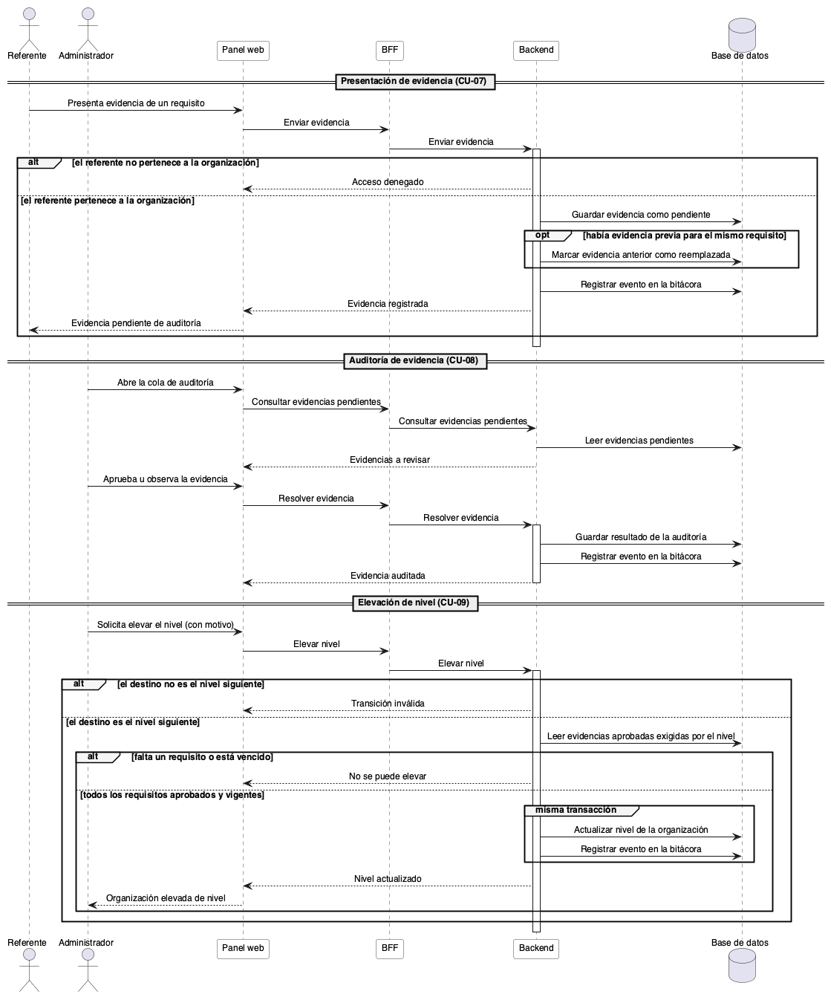
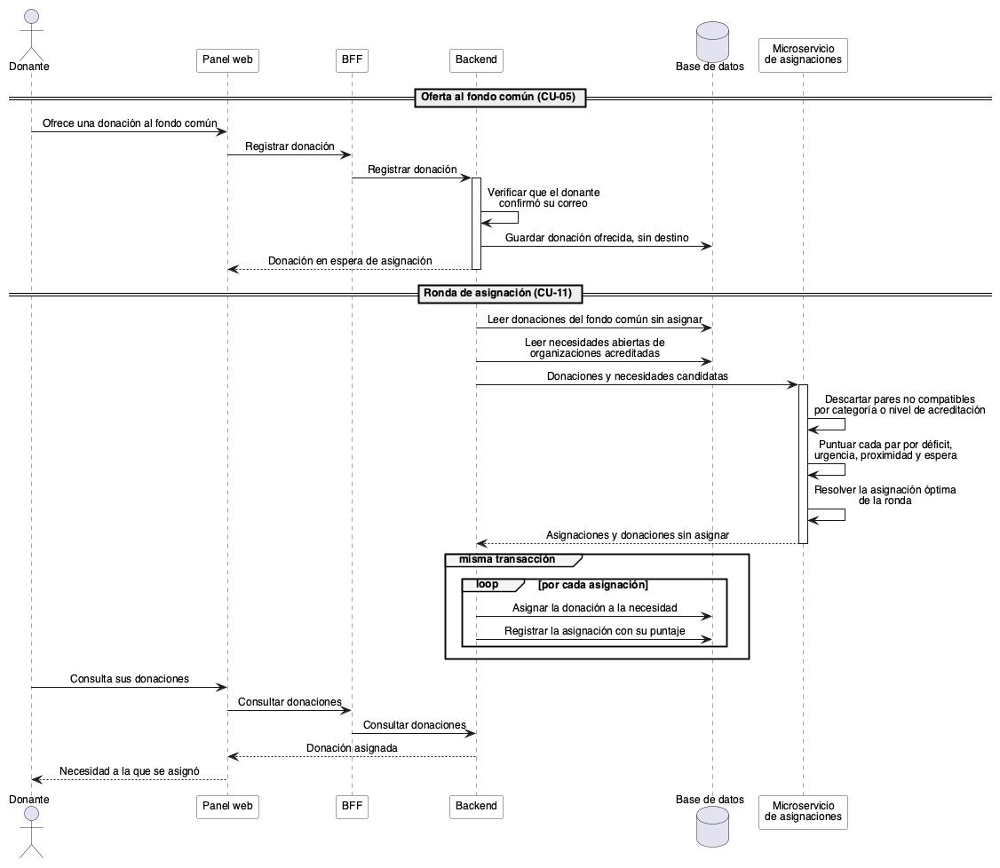
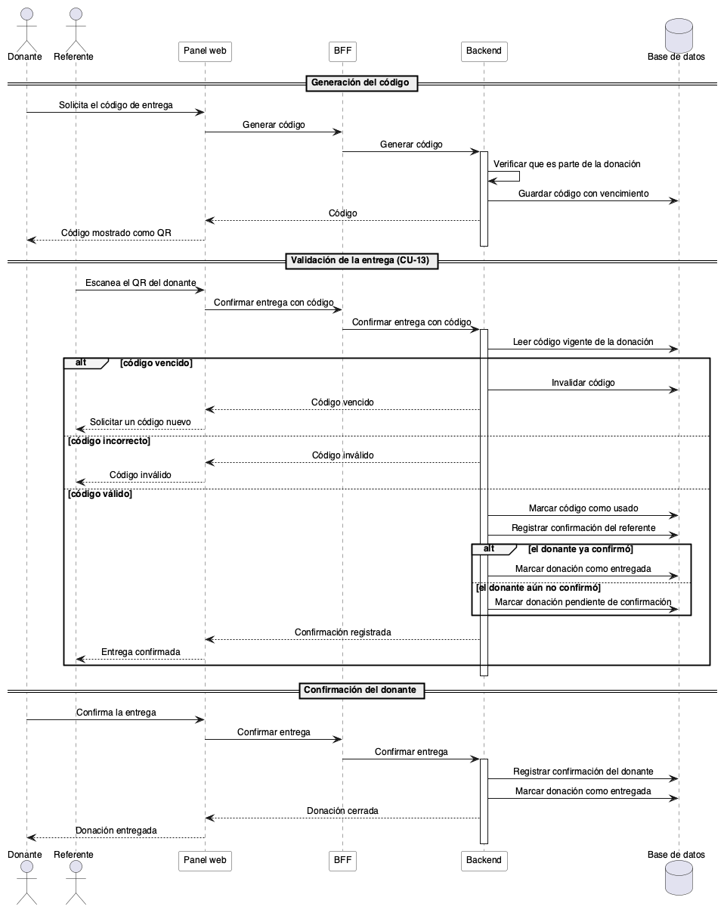
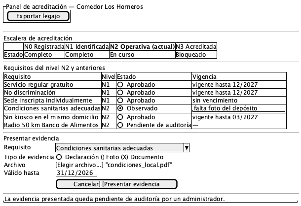
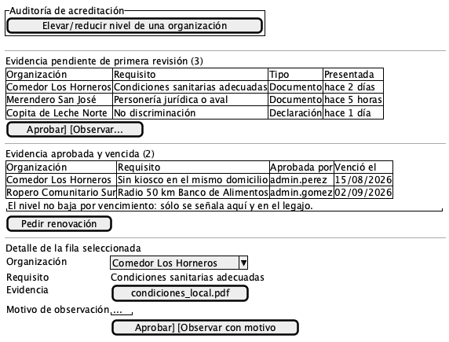
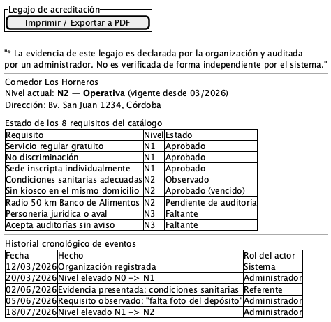
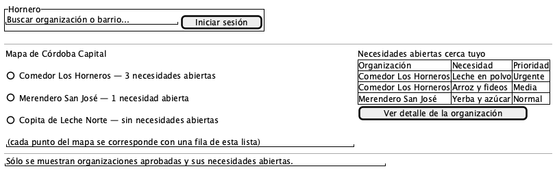
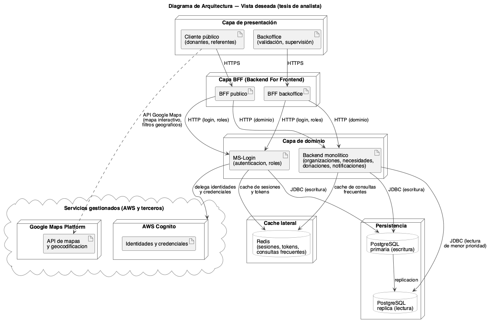
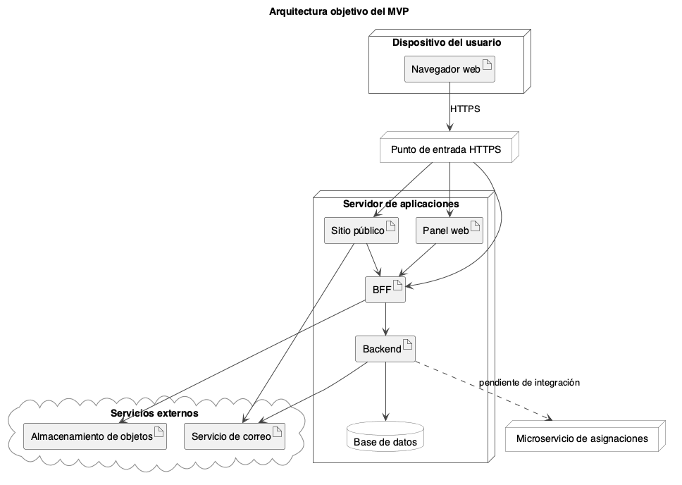

# Seminario Final de Ingeniería en Software — Hornero

**Título:** Sistema de acreditación, asignación priorizada y trazabilidad de donaciones
de alimentos.

> Documento de trabajo. El contenido está redactado para ser trasladado al `.docx` de
> entrega. Cada sección sigue el orden y la forma que pide la consigna.

---

## 1. Diagnóstico y Propuesta

### 1.1 Estado de situación

En Argentina, las organizaciones que brindan asistencia alimentaria de manera informal
—comedores, merenderos, copas de leche y espacios comunitarios sin personería jurídica—
quedan excluidas de los canales institucionales de donación, que exigen constitución
legal como requisito de acceso. El Banco de Alimentos Córdoba, por ejemplo, establece la
Personería Jurídica o Simple Asociación como requisito excluyente para dar de alta a un
comedor.

Su alternativa es la gestión fragmentada a través de redes sociales y mensajería
instantánea, donde no existe forma de acreditar identidad, actividad ni cumplimiento. De
ahí se desprenden cuatro consecuencias observables:

1. **El donante no puede distinguir** una organización legítima de una que no lo es.
2. **La organización no tiene cómo visibilizar su trabajo** ni construir antecedentes
   que le sirvan frente a terceros.
3. **Los recursos se concentran** en las organizaciones ya conocidas, mientras las zonas
   menos visibles quedan desabastecidas.
4. **No existe información pública** sobre dónde hay asistencia alimentaria y dónde no.

Los dos primeros problemas son de acreditación. El tercero es de asignación. El cuarto es
de información. Hornero se estructura sobre esos tres ejes, que son los tres del título.

### 1.2 La organización modelada

Hornero no releva una organización existente: es una organización modelada. El
diagnóstico, por lo tanto, no describe procesos internos de una entidad concreta, sino el
estado de situación del dominio en el que el prototipo interviene. Los requisitos
institucionales que el sistema toma como referencia sí provienen de una fuente real y
verificable: los que el Banco de Alimentos Córdoba publica para incorporar un comedor a
su red.

### 1.3 Propuesta

Hornero es un sistema de acreditación progresiva, asignación priorizada y trazabilidad de
donaciones de alimentos.

**Acreditación progresiva.** El sistema define una escalera de cuatro niveles de
validación. Cada nivel exige más evidencia que el anterior, y el nivel alcanzado
determina qué tipo de alimentos puede solicitar una organización y cuántos pedidos puede
mantener abiertos a la vez. El nivel más alto se alinea con los requisitos del Banco de
Alimentos Córdoba, de modo que alcanzarlo signifique estar en condiciones de darse de alta
allí. La organización puede exportar un **legajo de acreditación** con esa evidencia.

La evidencia se modela como **declarada y auditada**, no como verificada por el sistema.
Varios requisitos —condiciones sanitarias del local, ausencia de un kiosco en el mismo
domicilio, aceptación de auditorías sin aviso— son hechos de inspección física que ningún
software puede comprobar por sí mismo. Sostener lo contrario sería una falsedad técnica, y
el legajo lo declara de forma explícita.

**Asignación priorizada.** Un motor de asignación distribuye las donaciones que el donante
entrega al fondo común, combinando déficit de cobertura territorial, urgencia por
vencimiento, proximidad, tiempo de espera de la organización e historial de cumplimiento.
Las donaciones son indivisibles y cada necesidad se satisface con a lo sumo una donación
por ronda, lo que convierte el reparto en un problema de asignación resuelto con el
algoritmo húngaro.

El historial de cumplimiento es precisamente lo que la bitácora de trazabilidad hace
posible: sin registro no hay historial, y sin historial el motor asigna a ciegas respecto
de si la organización efectivamente recibió y confirmó lo que se le asignó antes. Conviene
marcar la distinción, porque son dos mecanismos distintos sobre la misma organización: el
**nivel de acreditación es un filtro duro** —determina qué puede pedir— mientras que el
**historial de cumplimiento es un peso del puntaje** —influye en cuánto prioriza el motor
esa necesidad frente a otras igualmente posibles—. Contar lo mismo de los dos lados
premiaría dos veces el mismo mérito.

**Cierre del ciclo de la donación.** La entrega se valida con un identificador único y un
código QR de un solo uso, con vencimiento automático, confirmado por las dos partes: el
donante que entrega y la organización que recibe. Una confirmación unilateral no cierra la
donación.

**Trazabilidad.** Todo cambio de estado relevante —presentación de evidencia, aprobación,
elevación o reducción de nivel, asignación de una donación— se registra como un evento en
una bitácora de sólo agregado. El estado actual se deriva de esa bitácora, que nunca se
actualiza ni se borra: una corrección es un evento nuevo, no la edición de uno viejo.

### 1.4 Qué problema resuelve cada eje

| Problema del diagnóstico | Eje que lo atiende |
|---|---|
| El donante no distingue organizaciones legítimas | Acreditación progresiva y legajo |
| La organización informal no accede a canales institucionales | Escalera alineada con el Banco de Alimentos |
| Concentración de recursos y desabastecimiento territorial | Motor de asignación con déficit de cobertura |
| Promesas de donación que no se concretan | Validación de entrega con QR de un solo uso e historial de cumplimiento |
| Ausencia de información pública | Mapa público y métricas de cobertura |

---

## 2. Objetivo del prototipo

Desarrollar un prototipo funcional que permita acreditar progresivamente organizaciones de
asistencia alimentaria, asignar donaciones priorizando la cobertura territorial y la
urgencia, y registrar de forma trazable el ciclo completo de cada donación y de cada
cambio en el nivel de acreditación.

---

## 3. Límites

**Desde** el registro de una organización de asistencia alimentaria o de un donante en la
plataforma,

**hasta** la entrega de una donación a una organización, validada por ambas partes con el
código de un solo uso, y el registro del evento correspondiente en la bitácora de
trazabilidad, incluyendo la exportación del legajo de acreditación que la organización
puede presentar ante terceros.

Quedan fuera de estos límites la logística de transporte de las donaciones, las pasarelas
de pago o donaciones monetarias, y toda operación posterior a la entrega —consumo,
rendición de cuentas o distribución interna dentro de la organización receptora.

---

## 4. Alcances

Dentro de los límites enunciados, el prototipo cubre los siguientes procesos.

### 4.1 Gestión de usuarios y acceso

- Registro y autenticación de tres roles: donante, referente de organización y
  administrador.
- Verificación de correo electrónico mediante código de un solo uso con vencimiento.
- Control de acceso aplicado en tres capas independientes: el microservicio de dominio, el
  BFF y la interfaz.

### 4.2 Acreditación progresiva

- Registro de organizaciones formales e informales.
- Presentación de evidencia por requisito, con su período de validez.
- Auditoría manual de cada evidencia por parte de un administrador, con observación
  fundada cuando corresponda.
- Elevación y reducción de nivel como acciones explícitas y fundamentadas, verificando que
  todos los requisitos del nivel de destino estén aprobados y vigentes.
- Señalamiento de la evidencia vencida. El nivel no desciende por sí solo: el sistema
  advierte, y la decisión de bajar el nivel queda registrada como acto de un administrador.
- Exportación del legajo de acreditación. El referente puede exportar la información que el
  sistema registra sobre la organización que representa; el administrador, la de cualquiera.

### 4.3 Publicación de necesidades

- Publicación, edición y cierre de necesidades por parte del referente.
- Límite por nivel de acreditación sobre la cantidad de necesidades abiertas
  simultáneamente y sobre las categorías de alimento que la organización puede solicitar.
- Vencimiento de necesidades por fecha.

### 4.4 Donaciones

- Dos modalidades: donación **directa**, en la que el donante elige la necesidad, y
  donación al **fondo común**, en la que el sistema decide el destino.
- Ciclo de estados de la donación con confirmación mutua de entrega entre donante y
  referente, y posibilidad de intervención administrativa fundada.
- Validación de la entrega mediante un identificador único y un código QR de un solo uso
  con vencimiento automático, confirmado por ambas partes.
- Asignación por rondas de las donaciones del fondo común, con registro del puntaje
  desglosado y del costo de oportunidad de cada asignación. Una donación asignada
  permanece asignada: el prototipo no la devuelve al fondo común.
- Incorporación del historial de cumplimiento de la organización como término del puntaje,
  con valor neutro para las organizaciones sin historial previo, de modo que una
  organización recién acreditada no quede penalizada por ser nueva.

### 4.5 Información pública

- Sitio público con el mapa de organizaciones acreditadas y sus necesidades abiertas, sin
  requerir cuenta.
- Métricas de cobertura territorial por radio censal, calculadas a partir del registro
  nacional de comedores y merenderos.

### 4.6 Trazabilidad

- Bitácora de sólo agregado sobre los cambios de estado de organizaciones y donaciones.
- Reconstrucción del nivel de acreditación a partir de la bitácora, verificada por prueba
  automatizada contra el valor almacenado.

### 4.7 Fuera del alcance del prototipo

- Logística y transporte de donaciones.
- Donaciones monetarias y pasarelas de pago.
- Integración automática con sistemas del Banco de Alimentos u organismos públicos: el
  legajo se exporta, no se transmite.
- Verificación automática de hechos de inspección física.
- Reasignación automática de donaciones no retiradas. El alcance del motor es la
  asignación de los recursos donados al fondo común; qué hacer con una donación que
  vuelve —porque nadie la retiró o porque la organización la rechazó— queda planteado como
  problema abierto y se discute en las conclusiones, no se implementa en el prototipo.
- Cobertura geográfica fuera de Córdoba Capital y su radio inmediato.

---

## 5. Descripción del Sistema (UML)

Esta sección traduce el diagnóstico y los alcances de las secciones 1 a 4 en requerimientos,
casos de uso y diagramas de secuencia. Las fuentes primarias son las especificaciones de
`openspec/changes/acreditacion-progresiva/specs/` y `openspec/specs/`, el documento de diseño
`openspec/changes/acreditacion-progresiva/design.md`, el diagrama de casos de uso
`docs/tesis/diagramas/casos-uso/general.puml` y el código fuente de `jar_hornero_ms`,
`ts_hornero_bff`, `ts_hornero_admin` y `go_algorithms_worker`.

Dos mecanismos descriptos en la sección 1.3 y en el alcance 4.4 —la donación al fondo común
con su ronda de asignación, y la validación de entrega con código QR de un solo uso— están
comprometidos como parte del alcance del prototipo pero, a la fecha de este documento, no
tienen persistencia ni endpoints implementados en `jar_hornero_ms`: el motor de asignación
existe como herramienta de línea de comandos por lotes (`go_algorithms_worker/main.go`,
comando `assign`) con su contrato de entrada y salida ya definido, pero sin un punto de
integración con el microservicio; y el código de entrega de un solo uso no tiene tabla ni
controlador propios, aunque el patrón de código con hash, vencimiento y un solo uso ya existe
implementado para la verificación de correo electrónico (`OtpService`). Los requerimientos y
los diagramas de secuencia de esta sección describen el mecanismo tal como está comprometido
en el documento y modelado sobre esos precedentes ya construidos; esta salvedad se repite en
los encabezados de los archivos `.puml` correspondientes.

### 5.1 Requerimientos funcionales

Agrupados por subsistema. Cada requerimiento resume una o varias reglas de las
especificaciones fuente; no reproduce cada escenario, que puede consultarse en el archivo de
especificación citado entre paréntesis.

**Gestión de usuarios y acceso**

- **RF-01.** El sistema debe permitir el registro y la autenticación de tres roles —donante,
  referente y administrador—. El registro de un referente debe exigir la creación de al menos
  una organización dentro del mismo flujo, y debe permitir reintentar la creación de la
  organización sin volver a registrar la cuenta si ese paso falla parcialmente
  (`referente-onboarding`).
- **RF-02.** El sistema debe verificar la dirección de correo electrónico mediante un código
  de un solo uso, con vencimiento y con un límite de intentos fallidos antes de invalidar el
  código (CU-12; `auth/otp/OtpService.java`).
- **RF-03.** El sistema debe aplicar control de acceso basado en rol en tres capas
  independientes y sincronizadas —microservicio, BFF e interfaz—, de modo que ningún endpoint
  nuevo quede accesible por omisión antes de declararse explícitamente protegido.

**Gestión de organizaciones**

- **RF-04.** El sistema debe permitir que un referente administre hasta 3 organizaciones, que
  cada organización tenga a lo sumo un referente, y que una organización sin referente
  asignado permanezca visible y operativa —tanto en el panel de administración como en el
  sitio público— sin perder su estado de validación (`referente-organizacion-assignment`,
  `admin-referente-management`).
- **RF-05.** El sistema debe permitir que el referente proponga cambios a los campos de
  información pública de su organización (aceptación de donaciones, sitio web, enlace de
  donación directa) sujetos a aprobación de un administrador antes de publicarse, mientras que
  un administrador puede editarlos directamente y sin aprobación (`organizacion-self-edit`,
  `organizacion-info-publica`).

**Acreditación progresiva**

- **RF-06.** El sistema debe representar la acreditación de una organización como un nivel
  dentro de una escalera de cuatro valores (N0 a N3), cada uno exigiendo de forma acumulativa
  el cumplimiento de un catálogo cerrado de 8 requisitos transcriptos de una fuente
  verificable (`organizacion-acreditacion`).
- **RF-07.** El sistema debe restringir las transiciones de nivel a un escalón por vez.
  Elevar un nivel debe ser una acción explícita de un administrador, que sólo procede si todos
  los requisitos exigidos por el nivel destino y los inferiores están aprobados y vigentes.
  Reducir un nivel debe ser también una acción explícita y fundamentada del administrador, y
  nunca un efecto automático (`organizacion-acreditacion`).
- **RF-08.** El sistema debe permitir que el referente presente evidencia por requisito —como
  declaración, foto o documento— con una ventana de validez propia. Reemplazar una evidencia
  debe insertar una fila nueva y marcar la anterior como reemplazada, sin sobrescribir ni
  borrar su contenido original (`organizacion-evidencia`).
- **RF-09.** El sistema debe reservar exclusivamente al administrador la potestad de aprobar u
  observar una evidencia presentada, registrando el motivo cuando se observa. El referente que
  presentó la evidencia no puede autoaprobarla (`organizacion-evidencia`).
- **RF-10.** El sistema debe derivar el vencimiento de una evidencia al momento de leerla, sin
  degradar el nivel de la organización como efecto de ese vencimiento por sí solo, y debe
  señalar la evidencia vencida en la cola de auditoría y en el legajo
  (`organizacion-evidencia`, política de "registrar y advertir").
- **RF-11.** El sistema debe registrar cada hecho relevante de acreditación —registro,
  evidencia presentada o reemplazada, requisito aprobado u observado, nivel elevado o
  reducido, referente reasignado— como un evento de sólo agregado, escrito en la misma
  transacción que el cambio de estado que describe, y debe garantizar mediante una prueba
  automatizada que reconstruir el nivel a partir de esos eventos coincide con el nivel
  almacenado (`organizacion-evento-log`).
- **RF-12.** El sistema debe permitir exportar el legajo de acreditación de una organización,
  con su nivel actual, el estado de cada requisito del catálogo, el historial cronológico
  completo de eventos, y una declaración explícita de que la evidencia es declarada y
  auditada por un administrador, no verificada por el sistema. El referente debe poder
  exportar la información de su propia organización, y el administrador la de cualquiera
  (CU-10; `organizacion-legajo`).

**Necesidades y donaciones**

- **RF-13.** El sistema debe limitar qué categorías de alimento puede solicitar una
  organización y cuántas necesidades puede mantener abiertas simultáneamente, en función de su
  nivel de acreditación vigente (CU-03; `organizacion-acreditacion`).
- **RF-14.** El sistema debe admitir dos modalidades de donación —directa, donde el donante
  elige la necesidad, y al fondo común, donde una ronda de asignación decide el destino—. La
  ronda de asignación al fondo común debe resolver el reparto mediante el algoritmo húngaro,
  ponderando déficit de cobertura territorial, urgencia, proximidad e historial de espera de
  la organización, filtrando de forma dura las categorías no habilitadas por el nivel de
  acreditación, y debe registrar el puntaje desglosado y el costo de oportunidad de cada
  asignación resuelta (CU-05, CU-11; `design.md` AD-10, `go_algorithms_worker/internal/assign`).
- **RF-15.** El sistema debe validar la entrega de una donación mediante un identificador
  único y un código de un solo uso con vencimiento automático, presentado como código QR, y
  debe exigir la confirmación de ambas partes —donante y referente— antes de considerar la
  donación entregada, admitiendo intervención administrativa fundada como excepción (CU-13;
  sección 1.3 y 4.4 de este documento; `DonacionService.confirmarEntrega`).

### 5.2 Requerimientos no funcionales

**Seguridad**

- **RNF-01.** La autenticación debe emitirse como JWT firmado (HS256) por el microservicio,
  con un secreto compartido idéntico entre el microservicio y el BFF, token de acceso de 15
  minutos y token de refresco de 7 días; el rol del usuario debe resolverse siempre desde el
  servidor (`GET /auth/me`), nunca decodificando el token en el cliente.
- **RNF-02.** Los archivos de evidencia de acreditación (fotos, documentos) deben servirse
  exclusivamente a través de una ruta autenticada y verificada por titularidad, nunca a través
  de la ruta pública de imágenes existente; todo endpoint GET nuevo bajo el prefijo de
  organizaciones debe declararse explícitamente autenticado en la configuración de seguridad,
  antes de cualquier regla de acceso público que pudiera alcanzarlo por prefijo
  (`design.md` AD-8).
- **RNF-03.** La validación de entrada debe rechazar esquemas de URL distintos de `http` y
  `https` en los campos de información pública editables (por ejemplo `javascript:` o
  `data:`), y debe rechazar valores compuestos únicamente por espacios en blanco
  (`organizacion-info-publica`).

**Rendimiento sobre el hardware de destino (Raspberry Pi 5)**

- **RNF-04.** La lectura del nivel de acreditación de una organización debe resolverse en
  tiempo constante desde una columna almacenada, sin reconstruir el nivel plegando el registro
  de eventos en cada lectura, dado que el microservicio corre junto a otros cuatro contenedores
  y PostgreSQL en el mismo dispositivo (`design.md` AD-1).
- **RNF-05.** La exportación del legajo no debe incorporar una dependencia de renderizado de
  PDF en el servidor (por ejemplo un navegador sin interfaz); debe apoyarse en la función de
  impresión a PDF del navegador del cliente, para evitar un proceso adicional de cientos de
  megabytes de memoria en un dispositivo con RAM limitada (`design.md` AD-11).
- **RNF-06.** El motor de asignación de donaciones al fondo común debe ejecutarse como un
  proceso por lotes independiente, no como un servicio residente, para no sumar un proceso
  permanente a la carga del dispositivo de despliegue.

**Disponibilidad**

- **RNF-07.** Los cambios de esquema y la migración de datos existentes deben ser aditivos,
  admitir nulos con valor por defecto, y ejecutarse mediante una rutina idempotente al inicio
  del microservicio, de modo que el despliegue y el retroceso a una versión anterior no
  requieran tiempo de inactividad más allá del reinicio del contenedor (`design.md` AD-7).
- **RNF-08.** Una organización que queda sin referente asignado (por ejemplo, por
  desactivación del referente) debe permanecer visible en el panel de administración y en el
  sitio público sin interrupción del servicio (`referente-organizacion-assignment`).

**Usabilidad**

- **RNF-09.** La interfaz debe presentar la edición pendiente de información pública y la cola
  de evidencia de acreditación pendiente como secciones visualmente distintas para el
  referente, nunca combinadas en una sola lista, de modo que el estado de cada flujo
  independiente sea inequívoco (`organizacion-self-edit`, `design.md` AD-4).
- **RNF-10.** El sitio público debe permitir explorar organizaciones y necesidades en el mapa
  sin requerir una cuenta, como vía de acceso anónimo y de baja fricción a la información.
- **RNF-11.** El flujo de validación de entrega con código de un solo uso debe informar de
  forma distinguible si el código está vencido, es inválido o fue confirmado, de modo que
  ambas partes puedan resolver el intercambio físico en el momento, sin un mensaje de error
  genérico.

**Mantenibilidad**

- **RNF-12.** El carácter de sólo agregado del registro de eventos debe garantizarse de forma
  estructural —la interfaz de acceso a datos no debe exponer operaciones de actualización ni
  de borrado para las filas de eventos— en lugar de depender únicamente de una convención de
  código verificable en tiempo de ejecución (`design.md` AD-3).
- **RNF-13.** La compatibilidad con el modelo de aprobación existente (`estado`, `validada`)
  debe mantenerse como una proyección derivada del nivel de acreditación, calculada por una
  única función, de modo que los consumidores existentes —sitio público, BFF— no requieran
  ningún cambio (`design.md` AD-6).

**Trazabilidad y auditabilidad**

- **RNF-14.** Todo hecho relevante de acreditación debe quedar registrado como un evento
  inmutable, escrito en la misma transacción que el estado que describe, de forma que ningún
  cambio de estado pueda persistir sin su evento correspondiente ni viceversa
  (`organizacion-evento-log`).
- **RNF-15.** La reconstrucción del nivel de acreditación a partir del registro de eventos
  debe coincidir con el nivel almacenado en todo momento, verificado mediante una prueba
  automatizada que actúa como invariante vinculante del sistema (`organizacion-evento-log`,
  `design.md` AD-3).

### 5.3 Descripción de casos de uso

Los trece casos de uso siguientes son exactamente los definidos en
`docs/tesis/diagramas/casos-uso/general.puml` (CU-01 a CU-13), con los mismos identificadores y
nombres. Cada descripción usa la plantilla estándar: identificador, nombre, actores,
precondición, poscondición, flujo principal numerado, flujos alternativos y excepciones.
El mismo conjunto se presenta desglosado por actor en `docs/tesis/diagramas/casos-uso/`:
`visitante`, `donante`, `referente`, `administrador` y `motor-asignacion`.

---

**CU-01 — Registrar organización**

- **Actores:** Visitante (anónimo), que se convierte en Referente al completar el registro.
- **Precondición:** el visitante no posee una cuenta previa con el correo electrónico
  utilizado.
- **Poscondición:** existe una cuenta de referente autenticada y al menos una organización en
  nivel N0, con `estado = PENDIENTE`, no visible públicamente.
- **Flujo principal:**
  1. El visitante completa el formulario de registro de cuenta (correo, contraseña, datos de
     contacto).
  2. El visitante completa los datos de la organización (tipo, dirección, descripción,
     ubicación mediante selector de mapa).
  3. El sistema crea la cuenta de referente y la organización asociada en el mismo flujo.
  4. El sistema autentica al referente y lo dirige a un panel funcional.
- **Flujos alternativos:**
  - 3a. Si la organización no pudo crearse tras crearse la cuenta (falla de red o del
    servidor), el sistema no exige volver a registrar la cuenta: ofrece un punto de reingreso
    para reintentar exclusivamente la creación de la organización desde `/pending-validation`.
- **Excepciones:**
  - El correo electrónico ya está registrado: el sistema rechaza el registro sin crear cuenta
    ni organización.

---

**CU-02 — Validar organización**

- **Actores:** Administrador.
- **Precondición:** existe una organización en nivel N0 con `estado = PENDIENTE`.
- **Poscondición:** la organización pasa a nivel N1 (`estado = APROBADA`) o permanece en N0
  con un evento de rechazo registrado; en ambos casos se agrega un evento a la bitácora en la
  misma transacción.
- **Flujo principal:**
  1. El administrador abre el listado de organizaciones pendientes de validación.
  2. El administrador revisa los datos declarados de la organización.
  3. El administrador aprueba la organización.
  4. El sistema eleva el nivel a N1, proyecta `estado = APROBADA` y `validada = true`, y
     registra el evento correspondiente.
- **Flujos alternativos:**
  - 3a. El administrador rechaza la organización en lugar de aprobarla: el sistema mantiene el
    nivel N0, fija `estado = RECHAZADA` y registra el evento de rechazo.
- **Excepciones:**
  - Un actor sin rol de administrador intenta aprobar o rechazar: el sistema rechaza la
    solicitud.

---

**CU-03 — Publicar necesidad**

- **Actores:** Referente.
- **Precondición:** el referente posee una organización con nivel de acreditación N1 o
  superior.
- **Poscondición:** existe una nueva necesidad en estado abierto, visible en el sitio público
  una vez que la organización está aprobada.
- **Flujo principal:**
  1. El referente completa los datos de la necesidad (descripción, prioridad, categoría de
     alimento, fecha de vencimiento).
  2. El sistema verifica que la categoría solicitada esté habilitada por el nivel de
     acreditación de la organización.
  3. El sistema verifica que la cantidad de necesidades abiertas de la organización no supere
     el cupo de su nivel.
  4. El sistema crea la necesidad en estado abierto.
- **Flujos alternativos:**
  - 1a. La necesidad se crea sin categoría (no clasificada): el paso 2 no aplica y la
    necesidad se comporta como hoy, sin la restricción de categoría.
- **Excepciones:**
  - La categoría solicitada no está habilitada por el nivel actual: el sistema rechaza la
    creación, identificando el nivel requerido.
  - La organización ya alcanzó el cupo de necesidades abiertas de su nivel: el sistema rechaza
    la creación, identificando el cupo del nivel.
  - La organización está en nivel N0: no puede publicar ninguna necesidad.

---

**CU-04 — Consultar necesidades en el mapa**

- **Actores:** Visitante (anónimo), Donante.
- **Precondición:** ninguna; el acceso es público y no requiere autenticación.
- **Poscondición:** el actor visualiza organizaciones acreditadas y sus necesidades abiertas
  en un mapa.
- **Flujo principal:**
  1. El actor abre el sitio público.
  2. El sistema solicita al BFF el listado de organizaciones aprobadas y sus necesidades
     abiertas.
  3. El sistema renderiza el mapa con los puntos de organización y sus necesidades asociadas.
  4. El actor puede filtrar o seleccionar una organización para ver su detalle.
- **Flujos alternativos:**
  - 4a. El actor navega al detalle de una organización específica (`/org/{slug}`).
- **Excepciones:**
  - Ninguna organización aprobada existe en el área consultada: el sistema muestra el mapa
    vacío, sin error.

---

**CU-05 — Ofrecer donación**

- **Actores:** Donante.
- **Precondición:** el donante tiene su correo electrónico verificado.
- **Poscondición:** existe una nueva donación en estado `OFRECIDA`, asociada a una necesidad
  específica (modalidad directa) o pendiente de ronda de asignación (modalidad fondo común).
- **Flujo principal:**
  1. El donante elige la modalidad de la donación: directa o al fondo común.
  2. En la modalidad directa, el donante selecciona la necesidad a la que destina la donación.
  3. El sistema verifica que el correo del donante esté verificado.
  4. El sistema crea la donación en estado `OFRECIDA`.
- **Flujos alternativos:**
  - 1a. Modalidad al fondo común (extiende CU-11): el donante no elige necesidad; la donación
    queda a la espera de la próxima ronda de asignación del motor por lotes.
- **Excepciones:**
  - El correo del donante no está verificado: el sistema rechaza la creación de la donación
    (véase CU-12).
  - La necesidad indicada no existe: el sistema rechaza la solicitud.

---

**CU-06 — Gestionar seguimiento de la organización**

- **Actores:** Referente.
- **Precondición:** el referente posee al menos una organización.
- **Poscondición:** el referente cuenta con una vista actualizada del estado de sus
  necesidades y donaciones, y puede proponer cambios a la información pública de su
  organización.
- **Flujo principal:**
  1. El referente abre el panel de su organización.
  2. El sistema muestra las necesidades publicadas y las donaciones asociadas, con su estado.
  3. El referente puede aceptar o rechazar una donación directa ofrecida a una de sus
     necesidades.
  4. El referente puede proponer cambios a los campos de información pública de la
     organización, sujetos a aprobación administrativa.
- **Flujos alternativos:**
  - 4a. El referente visualiza una propuesta de edición previamente enviada, aún pendiente de
    aprobación, distinguida de los valores actualmente publicados.
- **Excepciones:**
  - El referente intenta operar sobre una organización que no le pertenece: el sistema rechaza
    la solicitud.

---

**CU-07 — Presentar evidencia de acreditación**

- **Actores:** Referente.
- **Precondición:** el referente es titular de la organización para la que presenta evidencia.
- **Poscondición:** existe una nueva fila de evidencia en estado `PENDIENTE` para el requisito
  indicado, y se registró el evento correspondiente en la bitácora; si existía una evidencia
  previa para el mismo requisito, queda marcada como reemplazada sin perder su contenido.
- **Flujo principal:**
  1. El referente selecciona el requisito de acreditación a documentar.
  2. El referente completa el tipo de evidencia (declaración, foto o documento) y, cuando
     corresponde, la fecha de vencimiento de su validez.
  3. El sistema registra la evidencia en estado `PENDIENTE` dentro de una transacción.
  4. El sistema registra el evento de evidencia presentada en la misma transacción.
- **Flujos alternativos:**
  - 3a. Ya existe una evidencia previa para el mismo requisito: el sistema la marca como
    reemplazada y registra también ese evento, sin alterar los datos de la fila anterior.
- **Excepciones:**
  - El referente no es titular de la organización: el sistema rechaza la solicitud.

---

**CU-08 — Auditar evidencia presentada**

- **Actores:** Administrador.
- **Precondición:** existe al menos una evidencia en estado `PENDIENTE`.
- **Poscondición:** la evidencia queda en estado `APROBADA` u `OBSERVADA`, con el auditor y la
  fecha de revisión registrados, y se agregó el evento correspondiente a la bitácora. El nivel
  de acreditación de la organización no se modifica como efecto de este caso de uso.
- **Flujo principal:**
  1. El administrador abre la cola de evidencia pendiente de auditoría.
  2. El administrador revisa la evidencia presentada por el referente.
  3. El administrador aprueba la evidencia.
  4. El sistema fija el estado en `APROBADA`, registra auditor y fecha, y agrega el evento.
- **Flujos alternativos:**
  - 3a. El administrador observa la evidencia en lugar de aprobarla, indicando un motivo
    obligatorio: el sistema fija el estado en `OBSERVADA` y registra el motivo en el evento.
- **Excepciones:**
  - El referente que presentó la evidencia intenta aprobarla directamente: el sistema rechaza
    la solicitud.

---

**CU-09 — Elevar o reducir nivel de acreditación**

- **Actores:** Administrador.
- **Precondición:** la organización se encuentra en un nivel desde el cual existe una
  transición adyacente legal hacia el nivel solicitado.
- **Poscondición:** el nivel de la organización cambia al nivel destino, la proyección de
  `estado`/`validada` se actualiza en consecuencia, y se agrega un evento de elevación o
  reducción con actor y motivo, todo en la misma transacción.
- **Flujo principal:**
  1. El administrador solicita elevar el nivel de la organización al escalón inmediato
     superior, indicando un motivo.
  2. El sistema verifica que la transición sea legal (un solo escalón).
  3. El sistema verifica que todos los requisitos exigidos por el nivel destino y los
     inferiores estén aprobados y vigentes (véase CU-08, requisito "Verificar requisitos del
     nivel").
  4. El sistema eleva el nivel, proyecta el estado heredado y registra el evento.
- **Flujos alternativos:**
  - 1a. El administrador solicita reducir el nivel al escalón inmediato inferior, indicando un
    motivo obligatorio: el sistema no exige cobertura de requisitos para este sentido, aplica
    el cambio y registra el evento de reducción.
- **Excepciones:**
  - La transición solicitada salta más de un escalón (por ejemplo N0 a N2 directo): el sistema
    la rechaza como ilegal.
  - Falta o está vencido algún requisito exigido por el nivel destino: el sistema rechaza la
    elevación, sin modificar el nivel ni registrar un evento de cambio.
  - El motivo está vacío en una reducción: el sistema rechaza la solicitud.

---

**CU-10 — Exportar legajo de acreditación**

- **Actores:** Referente (de su propia organización), Administrador (de cualquier
  organización). El referente accede a la información de la organización que representa: la
  evidencia que él mismo presentó, el estado de cada requisito, el historial de decisiones
  sobre su acreditación y las observaciones fundadas que recibió. No accede a datos de
  ninguna otra organización.
- **Precondición:** la organización existe y el actor tiene permiso para consultarla.
- **Poscondición:** se genera una vista imprimible con la identidad de la organización, su
  nivel con fecha de vigencia, el estado de cada uno de los 8 requisitos del catálogo —incluso
  los que no tienen evidencia presentada (`FALTANTE`)— y el historial cronológico completo de
  eventos.
- **Flujo principal:**
  1. El actor abre la vista de legajo de la organización.
  2. El sistema ensambla el legajo en el microservicio, en formato JSON.
  3. El BFF reenvía la respuesta sin modificarla.
  4. La interfaz renderiza la vista imprimible, incluyendo la declaración de que la evidencia
     es declarada y auditada, no verificada por el sistema.
- **Flujos alternativos:**
  - 4a. El actor utiliza la función de impresión a PDF del navegador para exportar el legajo;
    no existe generación de PDF en el servidor.
- **Excepciones:**
  - Un actor sin permiso sobre la organización solicita su legajo: el sistema rechaza la
    solicitud.

---

**CU-11 — Asignar donaciones del fondo común**

- **Actores:** Motor de asignación (proceso por lotes).
- **Precondición:** existen donaciones en estado `OFRECIDA` destinadas al fondo común y al
  menos una necesidad abierta candidata.
- **Poscondición:** cada donación asignable queda vinculada a una necesidad, con su puntaje
  desglosado y su costo de oportunidad registrados; las donaciones sin candidato factible
  quedan señaladas como no asignadas en la ronda.
- **Flujo principal:**
  1. El proceso reúne las donaciones ofrecidas al fondo común y las necesidades candidatas
     abiertas de organizaciones acreditadas.
  2. El proceso calcula, para cada par donación-necesidad factible, un puntaje ponderado de
     déficit de cobertura, urgencia, proximidad e historial de espera.
  3. El proceso filtra de forma dura los pares cuya categoría de alimento no esté habilitada
     por el nivel de acreditación de la organización o no coincida con lo solicitado por la
     necesidad.
  4. El proceso resuelve la asignación óptima de la ronda mediante el algoritmo húngaro,
     maximizando el puntaje total.
  5. El sistema registra cada asignación resuelta con su puntaje y su costo de oportunidad.
- **Flujos alternativos:**
  - Ninguno: el proceso corre de punta a punta sin intervención humana durante la ronda.
- **Excepciones:**
  - Una donación no tiene ningún candidato factible en la ronda: queda señalada como no
    asignada y permanece disponible para una ronda posterior.
  - Una donación directa (con necesidad ya elegida por el donante) nunca llega a este proceso:
    no se reasigna.

---

**CU-12 — Verificar correo electrónico**

- **Actores:** Donante, Referente.
- **Precondición:** el usuario posee una cuenta registrada con correo electrónico no
  verificado.
- **Poscondición:** el correo del usuario queda marcado como verificado, habilitando
  operaciones que lo exigen (por ejemplo, ofrecer una donación).
- **Flujo principal:**
  1. El sistema envía un código de un solo uso al correo del usuario, con vencimiento.
  2. El usuario ingresa el código recibido.
  3. El sistema valida el código contra su valor almacenado (hash) y su vencimiento.
  4. El sistema marca el correo como verificado y el código como usado.
- **Flujos alternativos:**
  - 1a. El usuario solicita el reenvío del código: el sistema aplica un límite de frecuencia,
    invalida el código pendiente anterior y emite uno nuevo.
- **Excepciones:**
  - El código ingresado no coincide: el sistema incrementa el contador de intentos y rechaza
    la verificación.
  - Se supera el límite de intentos fallidos: el sistema invalida el código y exige solicitar
    uno nuevo.
  - El código ya venció: el sistema lo marca como usado y rechaza la verificación.

---

**CU-13 — Validar entrega con código de un solo uso**

- **Actores:** Donante, Referente.
- **Precondición:** existe una donación en un estado no terminal, aceptada o en camino, lista
  para su entrega física.
- **Poscondición:** la donación queda en estado `ENTREGADA` únicamente cuando ambas partes
  confirmaron la entrega; en caso contrario permanece en `PENDIENTE_CONFIRMACION` a la espera
  de la segunda confirmación.
- **Flujo principal:**
  1. Al encontrarse para la entrega, una de las partes solicita el código de entrega de un
     solo uso, con vencimiento, presentado como código QR.
  2. La otra parte escanea o ingresa el código.
  3. El sistema valida que el código sea correcto y no haya vencido, y lo marca como usado.
  4. El sistema registra la confirmación de la parte que validó el código.
  5. Cuando ambas partes confirmaron, el sistema marca la donación como `ENTREGADA` y fija la
     fecha de entrega.
- **Flujos alternativos:**
  - 5a. Sólo una parte confirmó hasta el momento: el sistema deja la donación en
    `PENDIENTE_CONFIRMACION`, a la espera de que la otra parte confirme por el mismo mecanismo
    o directamente desde su panel.
  - Intervención administrativa: un administrador puede forzar el estado de una donación no
    terminal con un motivo obligatorio, sin fabricar una confirmación de parte que no ocurrió.
- **Excepciones:**
  - El código presentado venció: el sistema lo invalida y rechaza la confirmación, exigiendo
    generar uno nuevo.
  - El código no coincide: el sistema rechaza la confirmación sin invalidar el código vigente.
  - Un actor ajeno a la donación (ni el donante ni el referente de la organización) intenta
    confirmar: el sistema rechaza la solicitud.

### 5.4 Diagramas de secuencia

Los tres diagramas siguientes están en `docs/tesis/diagramas/secuencia/` como archivos `.puml`,
renderizados a `.png` con PlantUML 1.2026.8. Se modelan a nivel de análisis: los participantes
son los componentes lógicos (panel web, BFF, backend, base de datos y microservicio de
asignaciones) y los mensajes describen la intención, no las rutas HTTP ni las sentencias SQL.

**Secuencia 1 — Evidencia, auditoría y elevación de nivel** (`secuencia/evidencia-acreditacion.puml`)

Cubre CU-07, CU-08 y CU-09 en una sola secuencia continua, porque son pasos consecutivos del
mismo proceso de acreditación: el referente presenta evidencia, el administrador la audita, y
sólo entonces el administrador puede elevar el nivel. El diagrama muestra explícitamente que
el cambio de nivel y su evento se escriben en la misma transacción, y que la elevación se
rechaza si algún requisito exigido está pendiente o vencido.

**Secuencia 2 — Donación al fondo común y ronda de asignación** (`secuencia/donacion-fondo-comun.puml`)

Cubre CU-05 (modalidad fondo común) y CU-11. Muestra al donante ofreciendo la donación, al
motor de asignación calculando el puntaje y resolviendo la ronda con el algoritmo húngaro, y
al microservicio registrando cada asignación con su puntaje desglosado y su costo de
oportunidad. El transporte entre el microservicio y el motor, y la persistencia de una donación dirigida al
fondo común, no están implementados en el código: el diagrama representa el contrato ya
definido en `go_algorithms_worker` (comando `assign`, tipos `Donacion`, `Candidato`,
`Resultado`) integrado del modo que el diseño (`design.md`, AD-10) da por supuesto.

**Secuencia 3 — Entrega validada con código QR de un solo uso** (`secuencia/entrega-qr.puml`)

Cubre CU-13. Muestra la generación del código de entrega, su validación por la contraparte, y
la confirmación mutua que cierra la donación, reflejando la máquina de estados ya implementada
en `DonacionService.confirmarEntrega` (estados `ACEPTADA` / `EN_CAMINO` /
`PENDIENTE_CONFIRMACION` / `ENTREGADA`). El mecanismo de código con hash, vencimiento y un solo
uso se modela sobre el patrón ya implementado en `OtpService` para la verificación de correo
electrónico; la tabla y el controlador específicos del código de entrega no existen aún en el
código.

---

## 6. Estructura de datos

Esta sección documenta el modelo de persistencia de Hornero: qué tabla existe para qué propósito,
qué significa cada columna en el dominio, y qué decisiones de modelado no son obvias a partir del
diagrama solo. Las dos referencias gráficas son `docs/tesis/diagramas/estructura/der.png` (diagrama
entidad-relación) y `docs/tesis/diagramas/estructura/clases.png` (diagrama de clases de dominio); ambas se
generan desde los archivos `.puml` homónimos y no se modifican en esta sección.

El esquema no tiene archivos de migración: se gestiona con `spring.jpa.hibernate.ddl-auto=update`
(ver `CLAUDE.md`, sección "MS persistence notes"), de modo que Hibernate deriva las tablas
directamente de las entidades JPA en `jar_hornero_ms/src/main/java/org/example/`. Esa es la fuente
de verdad que se usó para verificar cada columna de esta sección contra el código, no sólo contra
el diagrama.

Las siete tablas cubiertas están implementadas como entidades JPA. Cinco pertenecen al núcleo
original de la plataforma (`usuarios`, `organizaciones`, `necesidades`, `donaciones`,
`codigos_verificacion`); las dos restantes —`organizacion_evidencia` y `organizacion_evento`—, junto
con las columnas `organizaciones.nivel` y `necesidades.categoria`, se incorporaron con la
acreditación progresiva (`openspec/changes/archive/2026-09-21-acreditacion-progresiva/`).

### 6.1 Diccionario de datos

#### `usuarios`

Tabla única para los tres roles de la plataforma —administrador, referente y donante— mediante
herencia de tabla única (`SINGLE_TABLE`) con discriminador. Una fila es una cuenta con credenciales
propias; el rol no es un dato de negocio adicional sino el tipo mismo de la fila.

| Columna | Tipo | Nulo | Clave | Significado en el dominio |
|---|---|---|---|---|
| `id` | `BIGINT` | No | PK | Identificador interno de la cuenta. |
| `tipo` | `VARCHAR` | No | — | Discriminador de herencia (`ADMINISTRADOR`, `REFERENTE`, `DONANTE`). Viaja como claim `tipo` en el JWT y es la base de las tres capas de control de acceso descriptas en `CLAUDE.md`. |
| `nombre` | `VARCHAR` | No | — | Nombre de la persona titular de la cuenta. |
| `email` | `VARCHAR` | No (único) | — | Identidad de acceso. Es también la clave de correlación —sin FK— con `codigos_verificacion`. |
| `password` | `VARCHAR` | No | — | Hash BCrypt de la contraseña; nunca se persiste en texto plano. |
| `activo` | `BOOLEAN` | No | — | Habilita o inhabilita el acceso sin borrar la cuenta ni su historial asociado. |
| `email_verificado` | `BOOLEAN` | No | — | Resultado del flujo de verificación por código de un solo uso (CU-12). Condiciona operaciones que lo exigen, como ofrecer una donación. Las filas preexistentes a la introducción de esta columna migraron con valor `true` por defecto de columna (grandfathering), documentado en `Usuario.java`. |

#### `organizaciones`

Representa una organización de asistencia alimentaria administrada por un referente (opcional) y
validada por un administrador. Es la entidad alrededor de la cual giran la acreditación, la
publicación de necesidades y la visibilidad pública.

| Columna | Tipo | Nulo | Clave | Significado en el dominio |
|---|---|---|---|---|
| `id` | `BIGINT` | No | PK | Identificador interno. |
| `nombre` | `VARCHAR` | No | — | Nombre público de la organización. |
| `slug` | `VARCHAR` | Sí (único) | — | Identificador legible en URL para el detalle público (`/org/{slug}`). |
| `descripcion` | `VARCHAR(1000)` | Sí | — | Texto libre que describe la actividad de la organización. |
| `tipo` | `VARCHAR` (enum `TipoOrganizacion`) | Sí | — | Categoría del espacio (comedor, copita, ropero, merendero, otro). |
| `direccion` | `VARCHAR` | Sí | — | Dirección declarada del local. |
| `latitud` / `longitud` | `DOUBLE` | Sí | — | Coordenadas geográficas usadas por el mapa público y por el cálculo de proximidad del motor de asignación. |
| `validada` | `BOOLEAN` | No | — | Bandera legacy de aprobación administrativa. Es una **proyección** de `nivel` (`validada ⟺ nivel ≥ N1`), calculada por una única función (`proyectarEstadoLegacy`, AD-6 de `design.md`) para que ningún consumidor existente —sitio público, BFF— requiera cambios. |
| `estado` | `VARCHAR` (enum `EstadoOrganizacion`) | Sí | — | `PENDIENTE`, `APROBADA` o `RECHAZADA`. Proyección de `nivel` calculada por la misma función que `validada`; `RECHAZADA` se conserva mientras la organización no alcance `N1`. |
| `nivel` | `VARCHAR` (enum `NivelAcreditacion`) | Sí | — | Nivel de la escalera de acreditación (N0–N3). Es el modelo de lectura autoritativo: se lee en tiempo constante, sin reconstruir el nivel plegando `organizacion_evento` en cada lectura (RNF-04). Un valor nulo se interpreta como `N0`; la rutina de arranque `AcreditacionBackfill` lo completa en las organizaciones previas a la acreditación progresiva. |
| `administrador_id` | `BIGINT` | Sí | FK → `usuarios.id` | Último administrador que validó o rechazó la organización (`validadoPor`). Se sobrescribe en cada llamado: no es historial, sólo "quién tocó la aprobación por última vez". El historial lo lleva `organizacion_evento`. |
| `referente_id` | `BIGINT` | Sí | FK → `usuarios.id` | Referente a cargo de la organización. Es nulo cuando la organización queda sin referente asignado (por ejemplo, tras su desactivación); la organización permanece visible y operativa en ese caso (RNF-08). |
| `profile_image_key` / `banner_key` | `VARCHAR` | Sí | — | Claves de objeto en el bucket S3-compatible (Cloudflare R2 en producción) para la imagen de perfil y el banner. |
| `acepta_donaciones` | `BOOLEAN` | Sí | — | Campo de información pública: si la organización acepta donaciones en este momento. |
| `sitio_web_url` | `VARCHAR(500)` | Sí | — | Campo de información pública: enlace al sitio propio. |
| `donacion_directa_url` | `VARCHAR(500)` | Sí | — | Campo de información pública: enlace externo de donación directa. |
| `acepta_donaciones_pendiente` | `BOOLEAN` | Sí | — | Snapshot pendiente de aprobación del campo homónimo, propuesto por el referente (RF-05). |
| `sitio_web_url_pendiente` | `VARCHAR(500)` | Sí | — | Snapshot pendiente del campo homónimo. |
| `donacion_directa_url_pendiente` | `VARCHAR(500)` | Sí | — | Snapshot pendiente del campo homónimo. |
| `info_publica_pendiente_en` | `TIMESTAMP` | Sí | — | Marca de tiempo de la propuesta de edición pendiente; no nulo significa "hay un cambio esperando aprobación". |

Las cuatro columnas "pendiente" son un área de aprobación sobre la misma fila, no una tabla de
revisiones: sólo puede existir una propuesta pendiente por organización a la vez.

#### `organizacion_evidencia`

Almacena cada presentación de evidencia de un requisito de acreditación como una fila inmutable en
su contenido. Es la fuente de lo que un referente declaró y de lo que un administrador auditó por
requisito; no es una tabla de configuración ni una tabla de estado agregado de la organización.

| Columna | Tipo | Nulo | Clave | Significado en el dominio |
|---|---|---|---|---|
| `id` | `BIGINT` | No | PK | Identificador de la presentación. |
| `organizacion_id` | `BIGINT` | No | FK → `organizaciones.id` | Organización a la que corresponde la evidencia. |
| `requisito` | `VARCHAR` (enum `RequisitoAcreditacion`) | No | — | A cuál de los 8 requisitos del catálogo corresponde esta presentación. |
| `tipo_evidencia` | `VARCHAR` (`DECLARACION` \| `FOTO` \| `DOCUMENTO`) | No | — | Forma en la que se presenta la prueba: declaración de texto, fotografía o documento adjunto. |
| `object_key` | `VARCHAR` | Sí | — | Clave del archivo en el bucket S3-compatible, cuando el tipo de evidencia es `FOTO` o `DOCUMENTO`. |
| `declaracion` | `VARCHAR(2000)` | Sí | — | Texto de la declaración, cuando el tipo de evidencia es `DECLARACION`. |
| `valido_desde` | `DATE` | Sí | — | Inicio de la ventana de validez; por defecto, la fecha de presentación. |
| `valido_hasta` | `DATE` | Sí | — | Fin de la ventana de validez. Nulo significa que la evidencia no vence. |
| `estado` | `VARCHAR` (enum `EstadoEvidencia`) | No | — | `PENDIENTE`, `APROBADA`, `OBSERVADA` o `REEMPLAZADA`. Junto con los datos de la auditoría (`revisado_por`, `revisado_en`, `observacion`), es lo único que cambia después de la presentación. |
| `cargado_por` | `BIGINT` | No | id suelto, sin FK | Identificador del usuario (referente) que presentó la evidencia. Sin FK a propósito: la fila debe sobrevivir al borrado del usuario. |
| `cargado_en` | `TIMESTAMP` | No | — | Momento de la presentación. |
| `revisado_por` | `BIGINT` | Sí | id suelto, sin FK | Identificador del administrador que auditó la evidencia. |
| `revisado_en` | `TIMESTAMP` | Sí | — | Momento de la auditoría. |
| `observacion` | `VARCHAR(1000)` | Sí | — | Motivo registrado por el administrador cuando el estado pasa a `OBSERVADA`. |

Reemplazar una evidencia inserta una fila nueva en estado `PENDIENTE` y marca la fila anterior del
mismo requisito como `REEMPLAZADA`, sin sobrescribir ni borrar su contenido original. El vencimiento
(`expirada`) no se almacena: se deriva en el momento de la lectura comparando `valido_hasta` con la
fecha actual. Como en la bitácora, la interfaz de acceso a datos extiende `Repository<>` y no
`JpaRepository`, y no declara operaciones de borrado.

#### `organizacion_evento`

Bitácora de sólo agregado sobre los hechos relevantes de la acreditación de una organización:
registro, evidencia presentada o reemplazada, requisito aprobado u observado, nivel elevado o
reducido, referente reasignado. Es el historial de verdad; `organizaciones.nivel` es la proyección
de lectura derivada de esta tabla, y la reconstrucción de una coincide siempre con la otra por
invariante verificado con una prueba automatizada (RNF-15).

| Columna | Tipo | Nulo | Clave | Significado en el dominio |
|---|---|---|---|---|
| `id` | `BIGINT` | No | PK | Identificador del evento. |
| `organizacion_id` | `BIGINT` | No | FK → `organizaciones.id` | Organización a la que refiere el evento. |
| `tipo` | `VARCHAR` (enum `TipoEventoOrganizacion`) | No | — | Qué clase de hecho ocurrió (ver enumeraciones, 6.2). |
| `ocurrido_en` | `TIMESTAMP` | No | — | Momento del hecho, fijado por la fábrica del evento, nunca por quien lo invoca. |
| `actor_usuario_id` | `BIGINT` | Sí | id suelto, sin FK | Quién produjo el hecho (administrador o referente). Sin FK a propósito, para que el registro sobreviva al borrado de un usuario. |
| `actor_tipo` | `VARCHAR` | Sí | — | Rol del actor al momento del hecho (o `SISTEMA` para los eventos de la migración inicial). |
| `nivel_antes` | `VARCHAR` (enum `NivelAcreditacion`) | Sí | — | Nivel previo, sólo en eventos que cambian de nivel. |
| `nivel_despues` | `VARCHAR` (enum `NivelAcreditacion`) | Sí | — | Nivel resultante, sólo en eventos que cambian de nivel. |
| `requisito` | `VARCHAR` (enum `RequisitoAcreditacion`) | Sí | — | Requisito afectado, en eventos de evidencia o auditoría. |
| `evidencia_id` | `BIGINT` | Sí | id suelto, sin FK | Fila de `organizacion_evidencia` afectada. Sin FK por la misma razón que `actor_usuario_id`: el registro debe sobrevivir aunque la fila de evidencia fuera eliminada por otra vía. |
| `motivo` | `VARCHAR(1000)` | Sí | — | Justificación de una acción, obligatoria al observar evidencia o al reducir un nivel. |
| `payload` | `TEXT` | Sí | — | JSON canónico con el detalle específico del evento, para no forzar el esquema de la tabla a crecer con cada nuevo tipo de hecho. |

La tabla no admite `UPDATE` ni `DELETE` a nivel de repositorio: la interfaz de acceso a datos
correspondiente extiende `Repository<>`, no `JpaRepository`, y declara únicamente operaciones de
alta y de búsqueda (RNF-12).

#### `necesidades`

Un pedido de alimento publicado por una organización. Es la entidad sobre la que se ofrecen las
donaciones, tanto directas como del fondo común.

| Columna | Tipo | Nulo | Clave | Significado en el dominio |
|---|---|---|---|---|
| `id` | `BIGINT` | No | PK | Identificador de la necesidad. |
| `organizacion_id` | `BIGINT` | No | FK → `organizaciones.id` | Organización que publica la necesidad. |
| `descripcion` | `VARCHAR(1000)` | Sí | — | Detalle del pedido. |
| `prioridad` | `VARCHAR` (enum `PrioridadNecesidad`) | No | — | Urgencia declarada por el referente, ponderada por el motor de asignación del fondo común. |
| `estado` | `VARCHAR` (enum `EstadoNecesidad`) | No | — | Ciclo de vida de la necesidad. |
| `fecha_publicacion` | `DATE` | Sí | — | Fecha en la que se publicó la necesidad. |
| `fecha_vencimiento` | `DATE` | Sí | — | Fecha a partir de la cual la necesidad se considera vencida. |
| `categoria` | `VARCHAR` (enum `CategoriaAlimento`) | Sí | — | Categoría de alimento solicitada, que se cruza contra el nivel de acreditación de la organización al publicar la necesidad (RF-13, RF-14): cada categoría exige un nivel mínimo y, si la organización no lo alcanza, la publicación se rechaza. Una necesidad sin categoría se trata como no clasificada y no está sujeta a esa restricción. |

#### `donaciones`

El registro de una donación ofrecida por un donante hacia una necesidad, con su ciclo de estados
hasta la entrega confirmada por ambas partes.

| Columna | Tipo | Nulo | Clave | Significado en el dominio |
|---|---|---|---|---|
| `id` | `BIGINT` | No | PK | Identificador de la donación. |
| `donante_id` | `BIGINT` | No | FK → `usuarios.id` | Donante que ofrece la donación. |
| `necesidad_id` | `BIGINT` | No | FK → `necesidades.id` | Necesidad a la que se destina. En la modalidad de fondo común, esta columna es la que fija el destino recién resuelto en la ronda de asignación, según el diseño descripto en la sección 5.4 — mecanismo aún sin persistencia propia para el estado previo a la ronda, tal como se aclara en esa sección. |
| `fecha_oferta` | `DATE` | Sí | — | Fecha en la que el donante ofreció la donación. |
| `fecha_entrega` | `DATE` | Sí | — | Fecha en la que la entrega quedó confirmada por ambas partes. |
| `estado` | `VARCHAR` (enum `EstadoDonacion`) | No | — | Ciclo de vida de la donación (ver enumeraciones, 6.2). |
| `observaciones` | `VARCHAR(1000)` | Sí | — | Texto libre asociado a la donación. |
| `confirmada_donante_en` | `TIMESTAMP` | Sí | — | Momento en el que el donante confirmó la entrega. Nulo mientras no confirmó. |
| `confirmada_referente_en` | `TIMESTAMP` | Sí | — | Momento en el que el referente confirmó la entrega. Nulo mientras no confirmó. La donación pasa a `ENTREGADA` recién cuando ambas columnas están completas. |
| `override_motivo` | `VARCHAR(500)` | Sí | — | Motivo obligatorio de una intervención administrativa que fuerza el estado de la donación. |
| `override_admin_id` | `BIGINT` | Sí | id suelto, sin FK | Administrador que ejecutó el override, sin FK por consistencia con el resto de los identificadores de actor de este documento. |
| `override_en` | `TIMESTAMP` | Sí | — | Momento del override. |

#### `codigos_verificacion`

Un código de un solo uso emitido para verificar la titularidad de un correo electrónico (CU-12). El
patrón de esta tabla —hash del código, vencimiento, contador de intentos, marca de uso— es el mismo
que la sección 5 identifica como precedente para el futuro código de entrega de donaciones (CU-13).

| Columna | Tipo | Nulo | Clave | Significado en el dominio |
|---|---|---|---|---|
| `id` | `BIGINT` | No | PK | Identificador de la emisión del código. |
| `email` | `VARCHAR` | No | sin FK a `usuarios` | Correo al que se emitió el código. La correlación con `usuarios.email` es por igualdad de valor, no por clave foránea: el flujo de verificación se ejecuta antes de que el correo esté confirmado como propio de esa cuenta. |
| `codigo_hash` | `VARCHAR` | No | — | Hash BCrypt del código; el valor en texto plano nunca se persiste. |
| `expira_en` | `TIMESTAMP` | No | — | Vencimiento del código. |
| `intentos` | `INTEGER` | No | — | Contador de intentos fallidos, usado para invalidar el código tras superar el límite. |
| `usado` | `BOOLEAN` | No | — | Marca si el código ya fue consumido. |
| `creado_en` | `TIMESTAMP` | No | — | Momento de emisión. |

### 6.2 Enumeraciones

- **`NivelAcreditacion`** — Escalera de acreditación: `N0` (`REGISTRADA`,
  nada probado, sólo auto-registro), `N1` (`IDENTIFICADA`, identidad de la organización y de su
  referente, domicilio fijo y propósito de asistencia alimentaria declarados), `N2` (`OPERATIVA`,
  N1 más condiciones sanitarias adecuadas, ausencia de kiosco en el mismo domicilio y ubicación
  dentro de 50&nbsp;km del Banco de Alimentos Córdoba), `N3` (`ACREDITADA`, N2 más personería
  jurídica o aval y aceptación registrada de auditorías sin previo aviso). Los niveles son
  acumulativos: alcanzar `N3` exige que todos los requisitos de los niveles inferiores sigan
  aprobados y vigentes.
- **`RequisitoAcreditacion`** — Catálogo cerrado de 8 requisitos,
  transcriptos de los que publica el Banco de Alimentos Córdoba, cada uno asociado a un nivel
  exigido: `SERVICIO_REGULAR_GRATUITO` (N1, brindar un servicio de alimentación gratuito y regular
  en un espacio físico), `NO_DISCRIMINACION` (N1, no discriminar en la entrega por raza, religión,
  credo, vecindad o partido político), `SEDE_INSCRIPTA_INDIVIDUALMENTE` (N1, cada sede se inscribe
  por separado si la organización asiste en varios lugares), `CONDICIONES_SANITARIAS_ADECUADAS`
  (N2, instalaciones en condiciones sanitarias adecuadas al servicio prestado), `SIN_KIOSCO_MISMO_DOMICILIO`
  (N2, sin kiosco, almacén o despensa en el mismo domicilio), `RADIO_50KM_BANCO_ALIMENTOS` (N2,
  ubicación dentro de Córdoba Capital o hasta 50&nbsp;km del Banco de Alimentos), `PERSONERIA_JURIDICA_O_AVAL`
  (N3, personería jurídica propia o aval de otra personería, entre ocho opciones documentales
  admitidas), `ACEPTA_AUDITORIAS_SIN_AVISO` (N3, aceptación de visitas de auditoría sin aviso
  previo).
- **`EstadoEvidencia`** — `PENDIENTE` (presentada, sin revisar),
  `APROBADA` (auditada y aceptada por un administrador), `OBSERVADA` (auditada y devuelta con un
  motivo), `REEMPLAZADA` (superada por una presentación posterior del mismo requisito; conserva su
  contenido original).
- **`TipoEventoOrganizacion`** — Catálogo de hechos que puede registrar la
  bitácora: `MIGRACION_INICIAL` (evento sintético generado por la rutina de arranque para las
  organizaciones existentes antes de la escalera de niveles), `ORGANIZACION_REGISTRADA`,
  `REGISTRO_RECHAZADO`, `EVIDENCIA_ADJUNTADA`, `EVIDENCIA_REEMPLAZADA`, `REQUISITO_APROBADO`,
  `REQUISITO_OBSERVADO`, `NIVEL_ELEVADO`, `NIVEL_REDUCIDO`, `REFERENTE_REASIGNADO`.
- **`TipoEvidencia`** — `DECLARACION` (texto declarado por el referente), `FOTO` (fotografía
  adjunta), `DOCUMENTO` (documento adjunto). Los dos últimos guardan el archivo en el bucket y su
  clave en `object_key`.
- **`CategoriaAlimento`** — Categorías de alimento que una necesidad puede solicitar, cada una con
  el nivel mínimo de acreditación que exige: `NO_PERECEDERO` (desde `N1`), `REFRIGERADO` (desde
  `N2`) y `CONGELADO` (desde `N2`).
- **`EstadoOrganizacion`** — `PENDIENTE` (recién registrada, sin validar), `APROBADA` (validada por
  un administrador; proyección de `nivel ≥ N1`),
  `RECHAZADA` (rechazada explícitamente; se conserva en vez de volver a `PENDIENTE` para no reabrir
  el cupo de organizaciones del referente).
- **`TipoOrganizacion`** — `COMEDOR`, `COPITA`, `ROPERO`, `MERENDERO`, `OTRO`: categoría del espacio
  que declara la organización al registrarse.
- **`EstadoNecesidad`** — `ABIERTA` (visible y disponible para recibir donaciones), `EN_PROGRESO`
  (con al menos una donación en curso), `CUMPLIDA` (satisfecha), `VENCIDA` (pasó su fecha de
  vencimiento sin cumplirse).
- **`PrioridadNecesidad`** — `URGENTE`, `MEDIA`, `NORMAL`: urgencia declarada por el referente,
  usada como uno de los términos ponderados del motor de asignación del fondo común.
- **`EstadoDonacion`** — `OFRECIDA` (creada por el donante, aún sin decisión de la organización),
  `ACEPTADA` (la organización aceptó recibirla), `RECHAZADA` (la organización la rechazó),
  `EN_CAMINO` (en tránsito hacia la entrega), `PENDIENTE_CONFIRMACION` (una de las dos partes
  confirmó la entrega y falta la otra), `ENTREGADA` (ambas partes confirmaron; estado terminal),
  `CANCELADA` (interrumpida antes de la entrega, incluyendo por intervención administrativa
  fundada).

### 6.3 Decisiones de modelado que conviene explicar

- **Herencia de tabla única en `usuarios`.** Los tres roles comparten una sola tabla con un
  discriminador (`tipo`) en lugar de una tabla por rol, porque ninguna subclase agrega columnas
  propias: administrador, referente y donante difieren en comportamiento y en permisos, no en
  estructura de datos. Una tabla por rol exigiría uniones para cualquier consulta que no distinga
  rol (por ejemplo, buscar una cuenta por correo), sin ninguna columna adicional que lo justifique.

- **Columnas de snapshot pendiente en `organizaciones`.** `acepta_donaciones_pendiente`,
  `sitio_web_url_pendiente`, `donacion_directa_url_pendiente` e `info_publica_pendiente_en`
  duplican, con sufijo `_pendiente`, tres columnas que ya existen en la misma fila. La alternativa
  obvia —una tabla de propuestas de edición— fue descartada a propósito (AD-4 de `design.md`)
  porque el negocio sólo admite una propuesta pendiente por organización a la vez: modelar eso como
  una tabla aparte introduciría una cardinalidad (muchas propuestas por organización) que el
  dominio no usa, y obligaría a resolver qué hacer con propuestas concurrentes, un caso que
  simplemente no existe en el alcance del prototipo.

- **`actor_usuario_id` y `evidencia_id` sin clave foránea en `organizacion_evento`.** Es la
  excepción deliberada a que el resto del esquema sí use claves foráneas. La bitácora es un
  registro histórico: debe seguir siendo legible aunque el usuario que produjo un evento, o la fila
  de evidencia a la que refiere, ya no exista. Una clave foránea forzaría a elegir entre impedir el
  borrado del usuario o borrar en cascada su historial de acreditación, y ninguna de las dos
  opciones es aceptable para una bitácora de auditoría. El mismo criterio se aplicó ya al campo
  `override_admin_id` de `donaciones`.

- **`payload` como `text`, no como `jsonb`.** PostgreSQL normaliza `jsonb` al escribirlo: reordena
  claves, descarta duplicados y reformatea números. Eso significa que los bytes leídos de una fila
  `jsonb` no son necesariamente los bytes que se escribieron, lo que vuelve el contenido no
  verificable byte a byte —una propiedad que un futuro encadenamiento por hash sobre esta tabla
  necesitaría—. Guardar el payload como `text`, con una serialización canónica hecha por la
  aplicación (claves ordenadas alfabéticamente) en lugar de por la base de datos, evita esa pérdida
  a cambio de no poder usar operadores JSON en consultas; ninguna consulta actual necesita mirar
  dentro del payload, porque los datos que se consultan ya son columnas propias de la tabla
  (`tipo`, `nivel_antes`, `nivel_despues`, `requisito`, etc.).

- **Columnas aditivas y nulables por `ddl-auto=update` sin archivos de migración.** El esquema no
  tiene migraciones escritas a mano: Hibernate agrega columnas y tablas a partir de las entidades
  JPA en cada arranque. Esa herramienta no puede agregar una columna `NOT NULL` sin `DEFAULT` sobre
  una tabla con filas existentes, así que toda columna nueva —`organizaciones.nivel`,
  `necesidades.categoria`— se define nulable, con el valor por defecto fijado del lado de Java cuando hace
  falta, y cualquier corrección de datos existentes se resuelve con una rutina idempotente que corre
  al iniciar el microservicio (`AcreditacionBackfill`, que asigna `nivel` a las organizaciones ya
  existentes y registra su evento `MIGRACION_INICIAL`), no con una sentencia SQL suelta.

---

## 7. Prototipos de interfaces

Los prototipos siguientes son *wireframes* de baja fidelidad, escritos como diagramas `salt` de
PlantUML y renderizados a `.png` con la misma herramienta que el resto de los diagramas de este
documento (PlantUML 1.2026.8). No son capturas de pantalla de la aplicación en ejecución —el
prototipo funcional de la sección 2 se verifica corriendo el sistema, no con estas imágenes— sino
una forma de fijar, antes de programar la pantalla, qué información expone cada vista y qué
decisión de diseño queda visible en ella. Cada wireframe está en su propio archivo bajo
`docs/tesis/diagramas/` y se referencia aquí por su imagen renderizada.

### 7.1 Panel de acreditación del referente (`ui/evidencia-referente.puml`)

Sirve a CU-07 (presentar evidencia de acreditación) y, como contexto de lectura, a CU-09 y CU-10:
el referente necesita ver en qué nivel está su organización y qué le falta antes de poder pedirle a
un administrador que lo eleve, y necesita ver el mismo estado que después aparecerá en su legajo.

La pantalla hace visibles dos decisiones que, sin la interfaz, quedarían implícitas en el modelo de
datos. Primero, la escalera se muestra completa con los cuatro niveles y el nivel actual resaltado,
en lugar de mostrar sólo el nivel vigente: eso es lo que permite que el referente entienda qué
requisitos adicionales exige el escalón siguiente antes de presentar evidencia para él (RF-06,
RF-13). Segundo, cada requisito se lista con tres estados posibles —faltante, pendiente de
auditoría, aprobado con su vigencia, u observado con el motivo—, y no con un simple casillero de
"cumplido/no cumplido": esa distinción es la que hace visible que la evidencia es declarada por el
referente y auditada por un administrador, nunca autoaprobada (RF-09), y que un requisito aprobado
puede figurar vencido sin que el nivel de la organización baje por sí solo (RF-10, "registrar y
advertir").

### 7.2 Cola de auditoría del administrador (`ui/cola-auditoria.puml`)

Sirve a CU-08 (auditar evidencia presentada) y, en su franja superior, deja planteado el paso hacia
CU-09 (elevar o reducir nivel), que es una pantalla distinta y una acción distinta sobre la misma
organización.

La cola separa explícitamente la evidencia pendiente de primera revisión de la evidencia ya
aprobada que venció desde entonces, en lugar de mezclarlas en una sola lista de "atención
requerida": son dos hechos distintos que exigen decisiones distintas —aprobar u observar una
presentación nueva, frente a decidir si corresponde pedir su renovación—, y confundirlos ocultaría
que el sistema nunca baja un nivel por vencimiento; sólo lo señala (RF-10). Las acciones disponibles
sobre cada fila son únicamente aprobar u observar, con un motivo obligatorio para observar (RF-09,
CU-08): no existe un botón de "elevar nivel" en esta pantalla, porque aprobar un requisito y elevar
un nivel son dos actos administrativos separados a propósito (`design.md`, sección *Data Flow*),
para que un cambio de nivel siempre sea atribuible a una decisión explícita y no a un efecto
colateral de aprobar evidencia.

### 7.3 Vista imprimible del legajo (`ui/legajo.puml`)

Sirve a CU-10 (exportar legajo de acreditación), tanto para el referente sobre su propia
organización como para el administrador sobre cualquiera, según la decisión posterior registrada en
`decisiones-posteriores.md` (D-01) que amplía el acceso al legajo más allá del administrador.

Dos elementos de esta vista son deliberados y no decorativos. El primero es la declaración fija que
aparece antes del detalle de requisitos, indicando que la evidencia es declarada por la organización
y auditada por un administrador, y no verificada de forma independiente por el sistema: es la misma
salvedad de la sección 1.3 de este documento, y el legajo la deja explícita para que quien lo reciba
—por ejemplo, el Banco de Alimentos— no la infiera incorrectamente. El segundo es que el legajo
lista los 8 requisitos del catálogo completo, incluidos los que no tienen ninguna evidencia
presentada (`FALTANTE`), en lugar de listar sólo los aprobados: mostrar únicamente lo aprobado haría
que el legajo se pareciera a una certificación, cuando en realidad es un estado de situación
declarado. La vista no incluye un botón de descarga de PDF: se apoya en la función de impresión del
navegador (RNF-05, AD-11 de `design.md`), y el wireframe lo señala con una nota en vez de un botón,
para que quede claro que no hay generación de PDF en el servidor.

### 7.4 Mapa público de organizaciones y necesidades (`ui/mapa-publico.puml`)

Sirve a CU-04 (consultar necesidades en el mapa), el único caso de uso de acceso enteramente
anónimo de este documento.

La pantalla no pide ninguna credencial ni distingue un visitante de un donante autenticado (RNF-10):
el mapa y el listado de necesidades abiertas son los mismos para ambos. Sólo aparecen organizaciones
con `estado = APROBADA` y sus necesidades en estado `ABIERTA`: una organización en `N0` o con
necesidades vencidas o cumplidas no ocupa un lugar en esta vista, lo que es consistente con que la
acreditación es un filtro duro sobre qué puede publicarse (sección 1.3) y no simplemente un dato
más a mostrar. El detalle de una organización, accesible al seleccionar un punto del mapa, es la
puerta de entrada declarada por CU-04 hacia `/org/{slug}`.

---

## 8. Decisiones de arquitectura

La entrega de Seminario de Analista incluye una "Descripción a Nivel Técnico" que describe la
arquitectura con la que Hornero **se iba a construir**. Esta sección compara esa descripción con la
que **efectivamente corre**, y explica cada divergencia como una decisión tomada al contacto con la
implementación real —costo, autoalojamiento en una única Raspberry Pi, licenciamiento o
acoplamiento innecesario para la escala del sistema— y no como una omisión. Se presentan tres
vistas, en el orden en que conviene leerlas: primero la arquitectura deseada tal como fue descripta
en la entrega de analista, después la arquitectura que corre hoy, y por último la arquitectura
objetivo de este prototipo de ingeniería, que es la arquitectura actual más el alcance de
acreditación progresiva que sí entra en esta entrega.

### 8.1 Arquitectura deseada (tesis de analista)

La "Descripción a Nivel Técnico" de la entrega de Seminario de Analista (`entregas_tesis/Entrega
Seminario de Analista .docx`) describe, en sus propias palabras:

> "El sistema adopta una arquitectura cliente-servidor organizada en capas, con separación de
> responsabilidades y la incorporación del patrón Backend For Frontend (BFF) para desacoplar las
> interfaces de usuario de los servicios de negocio. […] La lógica de negocio se distribuye entre un
> microservicio de autenticación (MS-Login), responsable del inicio de sesión y la gestión de roles,
> y un backend monolítico que expone una API REST […]. De manera lateral, una instancia de Redis
> brinda soporte de cache para sesiones, tokens y consultas frecuentes […]. La capa de persistencia
> se implementa sobre PostgreSQL bajo un esquema primary/replica […]. La gestión de identidades y
> credenciales se delega en AWS Cognito. Finalmente, el sistema se integra con la API de Google Maps
> como servicio externo […]."

Esta vista es la que describe la entrega aprobada de analista: dos clientes web, cada uno con su
propio BFF; un microservicio de autenticación (MS-Login) separado del backend de dominio; Redis
como cache lateral de sesiones, tokens y consultas frecuentes; PostgreSQL con un esquema
primary/replica; AWS Cognito como proveedor de identidad; y la API de Google Maps consumida desde el
frontend. Ningún componente de esta vista existe en el código del repositorio a la fecha de
este documento: es exactamente lo que la siguiente subsección contrasta.

### 8.2 Arquitectura actual (lo que corre hoy)

La arquitectura que efectivamente corre está documentada en dos diagramas ya existentes en
`docs/tesis/diagramas/`, que esta sección referencia y **no vuelve a dibujar**:
`despliegue/general.png` (la vista independiente del hardware) y `despliegue/raspberry.png` (la
misma vista aplicada al autoalojamiento real en una Raspberry Pi 5 detrás de un Cloudflare Tunnel,
documentado en `docs/deploy-rpi-cloudflare.md`). Ambos se generan desde sus `.puml` homónimos, ya
descriptos en la sección de diagramas de despliegue.

En resumen, y verificado contra `docker-compose.yml` y el código de cada servicio a la fecha de este
documento: un único front público (Astro SSR), un único front autenticado (React/Vite SPA), un solo
BFF (NestJS) sin base de datos propia, un microservicio de dominio (Spring Boot) que también emite y
valida los JWT de autenticación, y una única instancia de PostgreSQL. No hay Redis, ni un segundo
BFF, ni un microservicio de autenticación separado, ni AWS Cognito, ni la API de Google Maps: el
mapa público y el selector de ubicación se renderizan con Leaflet sobre tiles de OpenStreetMap
(`ts_hornero_astro/src/components/islands/leaflet-map.tsx`,
`ts_hornero_admin/src/components/map/OrgLocationPicker.tsx`). Estos dos últimos puntos ya están
señalados como "**Free**" en el análisis de migración de frontend (`docs/frontend-migration-astro.md`,
tabla de acoplamientos), en el sentido de que no exigen clave de API ni facturación, a diferencia de
Google Maps Platform.

### 8.3 Divergencias y por qué cambiaron

| Tesis de analista | Lo que corre hoy | Por qué cambió |
|---|---|---|
| Microservicio de autenticación (MS-Login) | JWT emitido y validado por el microservicio de dominio (`jar_hornero_ms`), HS256, `JWT_SECRET` compartido con el BFF (`CLAUDE.md`, sección "Authentication & authorization") | Separar la autenticación en un servicio propio agrega un proceso, un contenedor y un punto de fallo más al único dispositivo de despliegue —una Raspberry Pi 5 corriendo ya cinco contenedores más PostgreSQL (`docs/deploy-rpi-cloudflare.md`)— sin que el sistema tenga una carga que lo justifique. Emitir el JWT desde el mismo microservicio de dominio evita ese servicio adicional sin renunciar a un emisor único y verificable. |
| Dos BFF, uno por cliente | Un solo BFF (NestJS), consumido tanto por el front público (SSR, sin cookies) como por la SPA autenticada (`withCredentials`, cookies httpOnly) | El split a dos BFF llegó a plantearse en un plan de backoffice separado (`docs/backoffice-admin-plan.md`, "Separate domain with its own BFF"), pero quedó postergado: el microservicio de dominio ya es el único emisor de JWT y el único dueño de la base de datos, así que un segundo BFF duplicaría el mismo proxy de autenticación y agregación sin aislar ninguna lógica de negocio adicional. Se mantiene como una división posible si el backoffice llega a separarse de dominio, no como una necesidad actual. |
| Redis para cache de sesiones y tokens | Sin Redis en el stack; ninguna sesión ni token se cachea fuera de la base de datos o del propio JWT | `docker-compose.yml` no declara ningún servicio `redis`. El propio cambio de acreditación progresiva, que necesitaba una expiración de evidencia comparable a una sesión con TTL, resolvió esa necesidad con una fila de PostgreSQL con fecha de expiración en lugar de un servicio nuevo (`openspec/changes/acreditacion-progresiva/design.md`, sección *Migration/Rollout*, "no new process, no daemon, no Redis, no scheduled job"), el mismo patrón ya usado por el código de verificación por email (`docs/otp-email-validation.md`). Agregar Redis sólo para cache de sesiones en un sistema con la carga de una única Raspberry Pi es un servicio más para operar sin una ganancia medible. |
| PostgreSQL primary/replica | Una única instancia de PostgreSQL (`docker-compose.yml`, servicio `postgres`), con datos persistidos en el volumen `hornero_pgdata` | Un esquema primary/replica exige un segundo proceso de PostgreSQL, la configuración de replicación entre ambos y su monitoreo, en un dispositivo con almacenamiento en microSD y sin equipo de operaciones dedicado (`docs/deploy-rpi-cloudflare.md`). El volumen de escritura y lectura de un sistema de este alcance no se acerca al punto en el que separar lecturas críticas de lecturas de menor prioridad aporte algo que una única instancia, con backups periódicos, no cubra ya. |
| AWS Cognito para identidad | JWT propio (HS256) más contraseñas con hash BCrypt, ambos dentro de `jar_hornero_ms` (columna `password : VARCHAR <<hash BCrypt>>` en `estructura/der.puml`, clase `JwtService`) | Delegar identidades en Cognito supone una dependencia de facturación y de una cuenta de AWS que el resto del stack no tiene: la producción corre autoalojada en una Raspberry Pi detrás de un Cloudflare Tunnel, y Railway —el único proveedor gestionado que el proyecto llegó a usar— fue decomisionado por completo (`CLAUDE.md`, sección "What this is"). Un emisor de JWT propio con contraseñas hasheadas con BCrypt cubre la misma necesidad de autenticación sin agregar un proveedor de identidad externo a una infraestructura que, deliberadamente, ya no depende de ningún servicio gestionado de nube. |
| API de Google Maps | Leaflet sobre tiles de OpenStreetMap, en el sitio público y en el selector de ubicación de la SPA | Google Maps Platform exige una clave de API y facturación pasado un umbral de uso gratuito; Leaflet con tiles de OpenStreetMap no requiere clave ni facturación para el volumen de uso de este sistema. Es la misma lógica de evitar dependencias de facturación externas que ya excluyó a AWS Cognito, aplicada al componente de mapa. |

**Dos requisitos no funcionales de la tesis de analista quedan superados por estas decisiones, y se
dicen aquí sin rodeos en lugar de dejarlos sin corregir.** La entrega de analista establece,
textualmente:

> **RNF03 – Seguridad / Autenticación.** "El sistema debe gestionar la autenticación y las
> credenciales mediante AWS Cognito, almacenar las contraseñas de forma cifrada (hash) y administrar
> el acceso mediante tokens."

> **RNF06 – Fiabilidad y disponibilidad.** "El sistema debe tener una disponibilidad objetivo del
> 99% mensual. El esquema PostgreSQL primary/replica debe garantizar la continuidad de las consultas
> ante una eventual falla."

Ambos son falsos sobre el sistema construido, y los diagramas `despliegue/general.puml` y
`despliegue/raspberry.puml` ya los contradicen: no hay Cognito ni hay una réplica de PostgreSQL en
ningún nodo desplegado. RNF03 queda cumplido por un mecanismo distinto y no menos válido para este
alcance: JWT HS256 emitido por el microservicio de dominio con `JWT_SECRET` compartido, contraseñas
con hash BCrypt, y `access_token`/`refresh_token` como cookies `httpOnly` para que ningún script en
el navegador pueda leerlos (`docs/security-access-token-httponly.md`). La autenticación se gestiona
mediante JWT propio, no mediante AWS Cognito; ambos son mecanismos de autenticación basados en
tokens, pero el requisito nombra explícitamente al segundo y ese es el que no se construyó. RNF06
queda sin cumplir tal como está escrito: no hay ningún mecanismo de continuidad de consultas ante
una falla de PostgreSQL, porque hay una única instancia sin réplica. Para el alcance real de este
prototipo —una plataforma para un número acotado de organizaciones y donantes, corriendo en un único
dispositivo autoalojado— esa disponibilidad no se sostiene con una arquitectura de base de datos
distribuida, sino con backups periódicos del volumen `hornero_pgdata` y con la tolerancia a una
ventana de indisponibilidad breve ante un reinicio del contenedor o del dispositivo. Es una
degradación deliberada del requisito original, no su cumplimiento encubierto, y se dimensiona contra
la carga real del sistema y no contra la disponibilidad que exigiría una plataforma con tráfico
constante y equipo de guardia.

### 8.4 Arquitectura objetivo del MVP

Esta vista no es una arquitectura distinta de la actual: es la arquitectura de la sección 8.2 con
el alcance de esta tesis de ingeniería incorporado.

La acreditación progresiva no agrega componentes: vive dentro del backend y de la misma base de
datos, como la columna `organizaciones.nivel`, la columna `necesidades.categoria` y las tablas
`organizacion_evento` y `organizacion_evidencia` descriptas en la sección 6. La escalera de
niveles, la bitácora, la cola de auditoría, el legajo y el tope por categoría de alimento funcionan
de punta a punta sin Redis, sin un servicio nuevo y sin un job programado (`design.md`, sección
*Migration/Rollout*).

Las fotografías y documentos de evidencia se guardan en el mismo almacenamiento de objetos que las
imágenes de las organizaciones, pero se leen por una ruta autenticada del BFF que verifica que quien
pide el archivo sea el referente de la organización o un administrador. La ruta pública de imágenes
rechaza cualquier clave de evidencia, de modo que ese material no queda expuesto.

El único componente nuevo es el microservicio de asignaciones, que resuelve las rondas del fondo
común (sección 5.4). Existe como proceso por lotes con su contrato de entrada y salida definido,
pero todavía no está integrado con el backend: por eso el diagrama lo muestra con una dependencia
punteada.

El resto de las divergencias de la sección 8.3 —el segundo BFF, Redis, la réplica de PostgreSQL,
AWS Cognito, Google Maps— no forman parte del alcance de esta tesis de ingeniería en ningún nivel,
ni en la arquitectura actual ni en la objetivo del MVP: son decisiones de arquitectura general del
sistema, no de esta entrega puntual.
