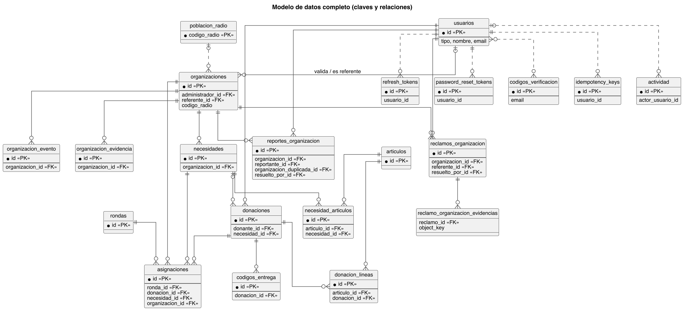
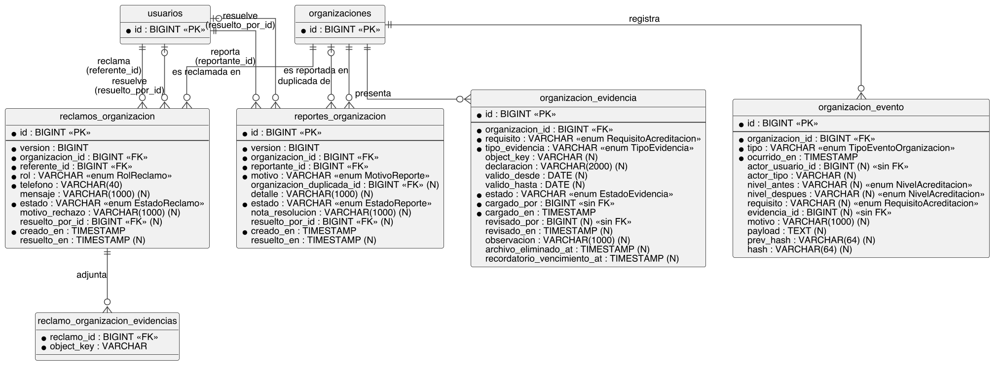
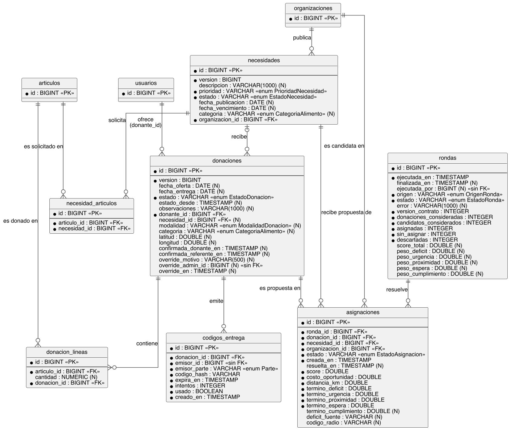
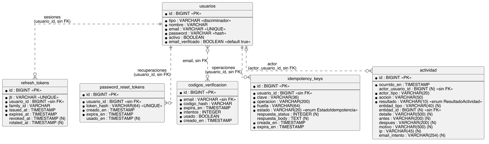
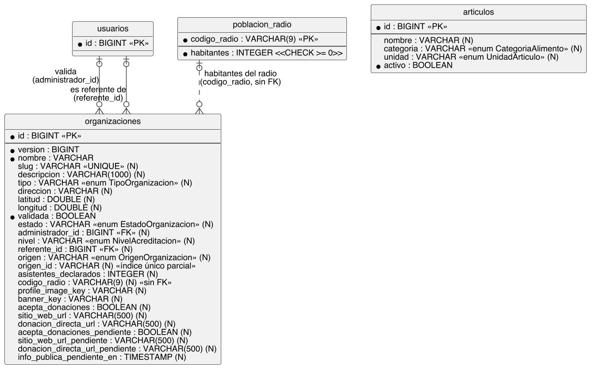

# Anexo D. Modelo de datos

## D.1 Fuente y criterios

El proyecto no tiene migraciones tradicionales. El esquema de PostgreSQL resulta de dos fuentes que se aplican en conjunto:

1. Las entidades JPA de `jar_hornero_ms/src/main/java/org/example/`, que Hibernate materializa con `spring.jpa.hibernate.ddl-auto=update` (`jar_hornero_ms/src/main/resources/application.yml`).
2. Los scripts idempotentes `scripts/sql/V001` a `V012`, que cubren lo que `ddl-auto=update` no puede hacer (relajar `NOT NULL`, ampliar `CHECK`, crear índices parciales, triggers).

Criterios de este anexo:

- Las restricciones listadas son las que declara la anotación (`@Column`, `@JoinColumn`, `@Table`, `@Index`) o un script SQL. No se agregó ninguna otra.
- Los nombres de columna siguen la convención de nombres por defecto de Spring Boot 3.2.5 (camelCase a snake_case); donde la anotación fija `name`, se usa ese nombre.
- Los tipos son los que Hibernate genera para el tipo Java (`Long` a BIGINT, `Instant` a TIMESTAMP, `String` sin longitud a VARCHAR(255), `Double` a DOUBLE PRECISION, `BigDecimal` a NUMERIC). Son tipos inferidos, no leídos de una base de datos real.
- **CHECK inferidos.** Las columnas con `@Enumerated(EnumType.STRING)` reciben de Hibernate 6 una restricción `CHECK` con los valores del enum. Esa restricción se infiere de la versión de Hibernate y no está declarada en las anotaciones; solo los scripts V007, V008 y V009 la redefinen de forma explícita (marcados abajo). Por eso, en las tablas, la columna de enum se indica como "enum (CHECK inferido)".
- Una columna `Long` sin `@ManyToOne` (por ejemplo `usuario_id` en `refresh_tokens`) no tiene clave foránea. Se indica "sin FK".
- Notación: PK clave primaria; FK clave foránea; NN `NOT NULL`; N admite nulos (sin `nullable = false`); UQ `UNIQUE`.
- Todas las claves primarias de tipo `Long` usan `GenerationType.IDENTITY`.

Diagramas (PlantUML y PNG en `docs/tfg/diagramas/`):

| Diagrama | Contenido |
|---|---|
| `er-completo` | Vista general: tablas, claves y relaciones |
| `er-acreditacion` | Organización, evidencia, eventos, reclamos y reportes |
| `er-donaciones-asignacion` | Necesidades, donaciones, códigos de entrega, rondas y asignaciones |
| `er-usuarios-sesiones` | Usuarios, tokens, OTP, idempotencia y actividad |
| `er-catalogo-territorio` | Organizaciones (detalle), artículos y población por radio censal |

## D.2 Enums que no son tablas

Los siguientes valores se guardan como texto en la columna indicada, sin tabla de referencia.

| Enum | Columnas donde se usa | Valores (según el código) |
|---|---|---|
| `RequisitoAcreditacion` | `organizacion_evidencia.requisito`, `organizacion_evento.requisito` | SERVICIO_REGULAR_GRATUITO, NO_DISCRIMINACION, SEDE_INSCRIPTA_INDIVIDUALMENTE, CONDICIONES_SANITARIAS_ADECUADAS, SIN_KIOSCO_MISMO_DOMICILIO, PERSONERIA_JURIDICA_O_AVAL, ACEPTA_AUDITORIAS_SIN_AVISO |
| `NivelAcreditacion` | `organizaciones.nivel`, `organizacion_evento.nivel_antes/despues` | N0, N1, N2, N3 |
| `TipoEvidencia` | `organizacion_evidencia.tipo_evidencia` | DECLARACION, FOTO, DOCUMENTO |
| `EstadoEvidencia` | `organizacion_evidencia.estado` | PENDIENTE, APROBADA, OBSERVADA, REEMPLAZADA |
| `TipoEventoOrganizacion` | `organizacion_evento.tipo` | MIGRACION_INICIAL, ORGANIZACION_REGISTRADA, REGISTRO_RECHAZADO, EVIDENCIA_ADJUNTADA, EVIDENCIA_REEMPLAZADA, REQUISITO_APROBADO, REQUISITO_OBSERVADO, NIVEL_ELEVADO, NIVEL_REDUCIDO, REFERENTE_REASIGNADO, IMPORTADA_RENACOM, RECLAMO_APROBADO, RECLAMO_RECHAZADO, REPORTE_CONFIRMADO, REPORTE_DESCARTADO |
| `EstadoOrganizacion` | `organizaciones.estado` | PENDIENTE, APROBADA, RECHAZADA, SIN_RECLAMAR, INACTIVA |
| `TipoOrganizacion` | `organizaciones.tipo` | COMEDOR, COPITA, ROPERO, MERENDERO, OTRO |
| `OrigenOrganizacion` | `organizaciones.origen` | PLATAFORMA, RENACOM |
| `PrioridadNecesidad` | `necesidades.prioridad` | URGENTE, MEDIA, NORMAL |
| `EstadoNecesidad` | `necesidades.estado` | ABIERTA, EN_PROGRESO, CUMPLIDA, VENCIDA |
| `CategoriaAlimento` | `necesidades.categoria`, `donaciones.categoria`, `articulos.categoria` | NO_PERECEDERO, REFRIGERADO, CONGELADO |
| `UnidadArticulo` | `articulos.unidad` | KG, PAQUETE, LITRO, UNIDAD |
| `EstadoDonacion` | `donaciones.estado` | OFRECIDA, ACEPTADA, RECHAZADA, EN_CAMINO, PENDIENTE_CONFIRMACION, ENTREGADA, CANCELADA |
| `ModalidadDonacion` | `donaciones.modalidad` | DIRECTA, FONDO_COMUN |
| `Parte` (`ParticipantesDonacion`) | `codigos_entrega.emisor_parte` | DONANTE, REFERENTE |
| `EstadoAsignacion` | `asignaciones.estado` | PROPUESTA, ACEPTADA, RECHAZADA, CANCELADA |
| `EstadoRonda` | `rondas.estado` | COMPLETADA, FALLIDA |
| `OrigenRonda` | `rondas.origen` | MANUAL, AUTOMATICA |
| `RolReclamo` | `reclamos_organizacion.rol` | RESPONSABLE, VOLUNTARIO, INTEGRANTE |
| `EstadoReclamo` | `reclamos_organizacion.estado` | PENDIENTE, APROBADO, RECHAZADO |
| `MotivoReporte` | `reportes_organizacion.motivo` | INACTIVO, DATOS_INCORRECTOS, DUPLICADO, OTRO |
| `EstadoReporte` | `reportes_organizacion.estado` | PENDIENTE, CONFIRMADO, DESCARTADO |
| `EstadoIdempotencia` | `idempotency_keys.estado` | EN_PROCESO, COMPLETADA |
| `ResultadoActividad` | `actividad.resultado` | EXITO, FALLO |

Los requisitos de acreditación son, por lo tanto, un enum Java y no una tabla: cada fila de `organizacion_evidencia` guarda el nombre del requisito como texto. `TipoActor` y `TipoActividad` de `actividad` se convierten con `AttributeConverter` a texto (VARCHAR 20 y 50); no llevan `@Enumerated`, así que Hibernate no les genera `CHECK`.

## D.3 Módulo de acreditación

### organizaciones

Entidad: `domain/Organizacion.java`. Se detalla en D.6 (catálogo y territorio) por su rol territorial; participa también en la acreditación (columnas `estado`, `nivel`, `referente_id`).

### organizacion_evidencia

Entidad: `domain/OrganizacionEvidencia.java`. Índice `idx_evidencia_org (organizacion_id)`.

| Columna | Tipo | Restricciones | Descripción |
|---|---|---|---|
| id | BIGINT | PK | Identificador de la evidencia. |
| organizacion_id | BIGINT | FK a organizaciones, NN | Organización que presenta la evidencia. |
| requisito | VARCHAR | NN; enum (CHECK inferido) | Requisito de acreditación que respalda. |
| tipo_evidencia | VARCHAR | NN; enum (CHECK inferido) | Declaración, foto o documento. |
| object_key | VARCHAR | N | Clave del archivo en el almacenamiento de objetos. |
| declaracion | VARCHAR(2000) | N | Texto de la declaración. |
| valido_desde | DATE | N | Inicio de vigencia (el constructor usa la fecha actual si no se indica). |
| valido_hasta | DATE | N | Fin de vigencia. |
| estado | VARCHAR | NN; enum (CHECK inferido) | Estado de revisión (se crea como PENDIENTE). |
| cargado_por | BIGINT | NN; sin FK | Id del usuario que cargó la evidencia. |
| cargado_en | TIMESTAMP | NN | Momento de carga. |
| revisado_por | BIGINT | N; sin FK | Id del usuario que revisó. |
| revisado_en | TIMESTAMP | N | Momento de revisión. |
| observacion | VARCHAR(1000) | N | Observación del revisor. |

### organizacion_evento

Entidad: `domain/OrganizacionEvento.java`. Índices `idx_evento_org_ocurrido (organizacion_id, ocurrido_en)` y único `ux_evento_org_prev_hash (organizacion_id, prev_hash)` (C4: impide que dos eventos de una organización tengan el mismo predecesor, es decir, una bifurcación de la cadena). Bitácora de eventos de acreditación, de solo agregado, encadenada por organización con SHA-256 (`hash = SHA-256(prev_hash || contenido canónico)`; ver `docs/tfg/seguridad-c4.md`). El script V014 agrega un disparador que rechaza `UPDATE`, `DELETE` y `TRUNCATE` (salvo el sellado único de una fila heredada).

| Columna | Tipo | Restricciones | Descripción |
|---|---|---|---|
| id | BIGINT | PK | Identificador del evento. |
| organizacion_id | BIGINT | FK a organizaciones, NN | Organización afectada. |
| tipo | VARCHAR | NN; CHECK explícito en V007, V008 y V009 (15 valores) | Tipo de evento. |
| ocurrido_en | TIMESTAMP | NN | Momento del evento. |
| actor_usuario_id | BIGINT | N; sin FK | Usuario que originó el evento. |
| actor_tipo | VARCHAR | N | Rol del actor o "SISTEMA". |
| nivel_antes | VARCHAR | N; enum (CHECK inferido) | Nivel previo, en cambios de nivel. |
| nivel_despues | VARCHAR | N; enum (CHECK inferido) | Nivel resultante. |
| requisito | VARCHAR | N; enum (CHECK inferido) | Requisito involucrado, en eventos de evidencia. |
| evidencia_id | BIGINT | N; sin FK | Evidencia involucrada. |
| motivo | VARCHAR(1000) | N | Motivo declarado. |
| payload | TEXT | N | Datos adicionales en texto. |
| prev_hash | VARCHAR(64) | N; parte del índice único `ux_evento_org_prev_hash` | Hash del evento anterior de la misma organización; 64 ceros para el primero. Nulo solo en filas anteriores al relleno de C4. |
| hash | VARCHAR(64) | N | `SHA-256(prev_hash \|\| contenido canónico)` en hexadecimal minúsculas. Nulo solo en filas anteriores al relleno de C4, que el microservicio sella al iniciar. |

### reclamos_organizacion

Entidad: `domain/ReclamoOrganizacion.java`. Índices `idx_reclamo_org_estado (organizacion_id, estado)` e `idx_reclamo_referente (referente_id)`. Script V008: índice único parcial `ux_reclamo_pendiente (organizacion_id, referente_id) WHERE estado = 'PENDIENTE'`.

| Columna | Tipo | Restricciones | Descripción |
|---|---|---|---|
| id | BIGINT | PK | Identificador del reclamo. |
| version | BIGINT | `@Version` (bloqueo optimista) | Contador de versión. |
| organizacion_id | BIGINT | FK a organizaciones, NN | Organización reclamada. |
| referente_id | BIGINT | FK a usuarios (Referente), NN | Referente que reclama. |
| rol | VARCHAR | NN; enum (CHECK inferido) | Rol declarado del reclamante. |
| telefono | VARCHAR(40) | NN | Teléfono de contacto (se vacía al anonimizar). |
| mensaje | VARCHAR(1000) | N | Mensaje del reclamante. |
| estado | VARCHAR | NN; enum (CHECK inferido); default Java PENDIENTE | Estado del reclamo. |
| motivo_rechazo | VARCHAR(1000) | N | Motivo si se rechaza. |
| resuelto_por_id | BIGINT | FK a usuarios (Administrador), N | Administrador que resolvió. |
| creado_en | TIMESTAMP | NN | Momento de creación. |
| resuelto_en | TIMESTAMP | N | Momento de resolución. |

### reclamo_organizacion_evidencias

Colección de elementos (`@ElementCollection`) de `ReclamoOrganizacion`; sin entidad propia y sin clave primaria declarada.

| Columna | Tipo | Restricciones | Descripción |
|---|---|---|---|
| reclamo_id | BIGINT | FK a reclamos_organizacion | Reclamo al que pertenece. |
| object_key | VARCHAR | NN | Clave del archivo de evidencia en el almacenamiento. |

### reportes_organizacion

Entidad: `domain/ReporteOrganizacion.java`. Índices `idx_reporte_org_estado (organizacion_id, estado)` e `idx_reporte_reportante (reportante_id)`. Script V009: índice único parcial `ux_reporte_pendiente (organizacion_id, reportante_id) WHERE estado = 'PENDIENTE'`.

| Columna | Tipo | Restricciones | Descripción |
|---|---|---|---|
| id | BIGINT | PK | Identificador del reporte. |
| version | BIGINT | `@Version` | Contador de versión. |
| organizacion_id | BIGINT | FK a organizaciones, NN | Organización reportada. |
| reportante_id | BIGINT | FK a usuarios, NN | Usuario que reporta. |
| motivo | VARCHAR | NN; enum (CHECK inferido) | Motivo del reporte. |
| organizacion_duplicada_id | BIGINT | FK a organizaciones, N | Organización de la que sería duplicada. |
| detalle | VARCHAR(1000) | N | Detalle libre. |
| estado | VARCHAR | NN; enum (CHECK inferido); default Java PENDIENTE | Estado del reporte. |
| nota_resolucion | VARCHAR(1000) | N | Nota del administrador. |
| resuelto_por_id | BIGINT | FK a usuarios (Administrador), N | Administrador que resolvió. |
| creado_en | TIMESTAMP | NN | Momento de creación. |
| resuelto_en | TIMESTAMP | N | Momento de resolución. |

## D.4 Módulo de donaciones y asignación

### necesidades

Entidad: `domain/Necesidad.java`. Script V003: `version` queda `NOT NULL DEFAULT 0`.

| Columna | Tipo | Restricciones | Descripción |
|---|---|---|---|
| id | BIGINT | PK | Identificador de la necesidad. |
| version | BIGINT | NN, default 0 (V003); `@Version` | Contador de versión. |
| descripcion | VARCHAR(1000) | N | Descripción. |
| prioridad | VARCHAR | NN; enum (CHECK inferido) | Prioridad. |
| estado | VARCHAR | NN; enum (CHECK inferido) | Estado de la necesidad. |
| fecha_publicacion | DATE | N | Fecha de publicación. |
| fecha_vencimiento | DATE | N | Fecha de vencimiento. |
| categoria | VARCHAR | N; enum (CHECK inferido) | Categoría de alimento. |
| organizacion_id | BIGINT | FK a organizaciones, NN | Organización que publica. |

### necesidad_articulos

Entidad: `domain/NecesidadArticulo.java`.

| Columna | Tipo | Restricciones | Descripción |
|---|---|---|---|
| id | BIGINT | PK | Identificador. |
| articulo_id | BIGINT | FK a articulos, NN | Artículo solicitado. |
| necesidad_id | BIGINT | FK a necesidades, NN | Necesidad que lo solicita. |

### donaciones

Entidad: `domain/Donacion.java`. Scripts: V001 (`necesidad_id` admite nulos), V003 (`version` NN default 0), V005 (relleno de `estado_desde`).

| Columna | Tipo | Restricciones | Descripción |
|---|---|---|---|
| id | BIGINT | PK | Identificador de la donación. |
| version | BIGINT | NN, default 0 (V003); `@Version` | Contador de versión. |
| fecha_oferta | DATE | N | Fecha en que se ofreció. |
| fecha_entrega | DATE | N | Fecha de entrega. |
| estado | VARCHAR | NN; enum (CHECK inferido) | Estado de la donación. |
| estado_desde | TIMESTAMP | N | Momento en que entró al estado actual (se completa en `@PrePersist`). |
| observaciones | VARCHAR(1000) | N | Observaciones. |
| donante_id | BIGINT | FK a usuarios (Donante), NN | Donante. |
| necesidad_id | BIGINT | FK a necesidades, N (V001) | Necesidad destino; nula en el fondo común. |
| modalidad | VARCHAR | N; no actualizable; enum (CHECK inferido) | Directa o fondo común. |
| categoria | VARCHAR | N; enum (CHECK inferido) | Categoría de alimento. |
| latitud | DOUBLE | N | Latitud de origen. |
| longitud | DOUBLE | N | Longitud de origen. |
| confirmada_donante_en | TIMESTAMP | N | Confirmación del donante. |
| confirmada_referente_en | TIMESTAMP | N | Confirmación del referente. |
| override_motivo | VARCHAR(500) | N | Motivo de una intervención administrativa. |
| override_admin_id | BIGINT | N; sin FK | Administrador que intervino. |
| override_en | TIMESTAMP | N | Momento de la intervención. |

### donacion_lineas

Entidad: `domain/DonacionLinea.java`.

| Columna | Tipo | Restricciones | Descripción |
|---|---|---|---|
| id | BIGINT | PK | Identificador. |
| articulo_id | BIGINT | FK a articulos, NN | Artículo donado. |
| cantidad | NUMERIC | N | Cantidad. |
| donacion_id | BIGINT | FK a donaciones, NN | Donación a la que pertenece. |

### codigos_entrega

Entidad: `donacion/entrega/CodigoEntrega.java`.

| Columna | Tipo | Restricciones | Descripción |
|---|---|---|---|
| id | BIGINT | PK | Identificador. |
| donacion_id | BIGINT | FK a donaciones, NN | Donación que se confirma. |
| emisor_id | BIGINT | NN; sin FK | Usuario que emite el código. |
| emisor_parte | VARCHAR | NN; enum (CHECK inferido) | Parte que emite (donante o referente). |
| codigo_hash | VARCHAR | NN | Hash del código (no se guarda en claro). |
| expira_en | TIMESTAMP | NN | Vencimiento. |
| intentos | INTEGER | NN; default Java 0 | Intentos de verificación. |
| usado | BOOLEAN | NN; default Java false | Indica si ya se consumió. |
| creado_en | TIMESTAMP | NN | Momento de emisión. |

### rondas

Entidad: `domain/Ronda.java`. Script V002: `ejecutada_por` admite nulos.

| Columna | Tipo | Restricciones | Descripción |
|---|---|---|---|
| id | BIGINT | PK | Identificador de la ronda. |
| ejecutada_en | TIMESTAMP | NN | Inicio de la ejecución. |
| finalizada_en | TIMESTAMP | N | Fin de la ejecución. |
| ejecutada_por | BIGINT | N (V002); sin FK | Usuario que la disparó; nulo en rondas automáticas. |
| origen | VARCHAR(20) | NN; default `'MANUAL'` (`columnDefinition`); enum (CHECK inferido) | Manual o automática. |
| estado | VARCHAR | NN; enum (CHECK inferido) | Completada o fallida. |
| error | VARCHAR(1000) | N | Mensaje de error. |
| version_contrato | INTEGER | NN | Versión del contrato con el worker. |
| donaciones_consideradas | INTEGER | NN | Donaciones evaluadas. |
| candidatos_considerados | INTEGER | NN | Candidatos evaluados. |
| asignadas | INTEGER | NN | Donaciones asignadas. |
| sin_asignar | INTEGER | NN | Donaciones sin asignar. |
| descartadas | INTEGER | NN | Donaciones descartadas. |
| score_total | DOUBLE | N | Puntaje total. |
| peso_deficit, peso_urgencia, peso_proximidad, peso_espera, peso_cumplimiento | DOUBLE | N | Pesos de la función de puntaje usados en la ronda. |

### asignaciones

Entidad: `domain/Asignacion.java`. Índices `idx_asignaciones_donacion (donacion_id)` e `idx_asignaciones_ronda (ronda_id)`.

| Columna | Tipo | Restricciones | Descripción |
|---|---|---|---|
| id | BIGINT | PK | Identificador. |
| ronda_id | BIGINT | FK a rondas, NN | Ronda que la produjo. |
| donacion_id | BIGINT | FK a donaciones, NN | Donación propuesta. |
| necesidad_id | BIGINT | FK a necesidades, NN | Necesidad destino. |
| organizacion_id | BIGINT | FK a organizaciones, NN | Organización destino. |
| estado | VARCHAR | NN; enum (CHECK inferido) | Propuesta, aceptada, rechazada o cancelada. |
| creada_en | TIMESTAMP | NN | Momento de creación. |
| resuelta_en | TIMESTAMP | N | Momento de resolución. |
| score | DOUBLE | NN | Puntaje de la asignación. |
| costo_oportunidad | DOUBLE | NN | Costo de oportunidad. |
| distancia_km | DOUBLE | NN | Distancia donación a organización. |
| termino_deficit, termino_urgencia, termino_proximidad, termino_espera | DOUBLE | NN | Términos del puntaje. |
| termino_cumplimiento | DOUBLE | N | Término de cumplimiento. |
| deficit_fuente | VARCHAR | N | Origen del dato de déficit. |
| codigo_radio | VARCHAR | N | Radio censal usado en el cálculo. |

## D.5 Módulo de usuarios y sesiones

### usuarios

Entidad: `user/Usuario.java`, herencia `SINGLE_TABLE` con columna discriminadora `tipo`; subclases `Administrador`, `Referente` y `Donante` (`user/*.java`), que no agregan columnas.

| Columna | Tipo | Restricciones | Descripción |
|---|---|---|---|
| id | BIGINT | PK | Identificador. |
| tipo | VARCHAR | Discriminador (ADMINISTRADOR, REFERENTE, DONANTE) | Rol del usuario; es el claim `tipo` del JWT. |
| nombre | VARCHAR | NN | Nombre. |
| email | VARCHAR | NN, UQ | Correo electrónico. |
| password | VARCHAR | NN | Hash de la contraseña. |
| activo | BOOLEAN | NN; default Java true | Cuenta activa. |
| email_verificado | BOOLEAN | NN; default de columna `true` (`columnDefinition`) | Correo verificado. |

### refresh_tokens

Entidad: `auth/RefreshToken.java`. Índices `idx_refresh_tokens_family (familyId)` e `idx_refresh_tokens_usuario (usuarioId)`.

| Columna | Tipo | Restricciones | Descripción |
|---|---|---|---|
| id | BIGINT | PK | Identificador. |
| jti | VARCHAR | NN, UQ | Identificador del token. |
| usuario_id | BIGINT | NN; sin FK | Usuario dueño. |
| family_id | VARCHAR | NN | Familia de rotación del token. |
| issued_at | TIMESTAMP | NN | Emisión. |
| expires_at | TIMESTAMP | NN | Vencimiento. |
| revoked_at | TIMESTAMP | N | Revocación. |
| rotated_at | TIMESTAMP | N | Rotación. |

### password_reset_tokens

Entidad: `auth/reset/PasswordResetToken.java`. Índice `idx_password_reset_usuario (usuarioId)`.

| Columna | Tipo | Restricciones | Descripción |
|---|---|---|---|
| id | BIGINT | PK | Identificador. |
| usuario_id | BIGINT | NN; sin FK | Usuario que recupera la contraseña. |
| token_hash | VARCHAR(64) | NN, UQ | Hash del token. |
| creado_en | TIMESTAMP | NN | Creación. |
| expira_en | TIMESTAMP | NN | Vencimiento. |
| usado_en | TIMESTAMP | N | Uso. |

### codigos_verificacion

Entidad: `auth/otp/CodigoVerificacion.java`. Códigos de un solo uso por correo.

| Columna | Tipo | Restricciones | Descripción |
|---|---|---|---|
| id | BIGINT | PK | Identificador. |
| email | VARCHAR | NN; sin FK | Correo destinatario. |
| codigo_hash | VARCHAR | NN | Hash del código. |
| expira_en | TIMESTAMP | NN | Vencimiento. |
| intentos | INTEGER | NN; default Java 0 | Intentos fallidos. |
| usado | BOOLEAN | NN; default Java false | Consumido. |
| creado_en | TIMESTAMP | NN | Creación. |

### idempotency_keys

Entidad: `idempotencia/ClaveIdempotencia.java`. Restricción única `uk_idempotency_usuario_clave_operacion (usuario_id, clave, operacion)`; índice `idx_idempotency_expira (expira_en)`.

| Columna | Tipo | Restricciones | Descripción |
|---|---|---|---|
| id | BIGINT | PK | Identificador. |
| usuario_id | BIGINT | NN; sin FK | Usuario. |
| clave | VARCHAR(36) | NN | Clave enviada por el cliente. |
| operacion | VARCHAR(200) | NN | Operación protegida. |
| huella | VARCHAR(64) | NN | Huella de la solicitud. |
| estado | VARCHAR(20) | NN; enum (CHECK inferido) | En proceso o completada. |
| respuesta_status | INTEGER | N | Código HTTP guardado. |
| respuesta_body | TEXT | N | Cuerpo guardado. |
| creada_en | TIMESTAMP | NN | Creación. |
| expira_en | TIMESTAMP | NN | Vencimiento. |

### actividad

Entidad: `actividad/Actividad.java` (`@Immutable`, insertar solamente). Índices `idx_actividad_ocurrido`, `idx_actividad_actor`, `idx_actividad_accion` e `idx_actividad_entidad (entidad_tipo, entidad_id)`. Scripts V004 y V006: triggers que rechazan `UPDATE`, `DELETE` y `TRUNCATE` salvo en la purga por retención (`hornero.purga_actividad = 'on'`); V006 permite además poner `email_intento` en NULL si el resto de la fila no cambia. Las columnas son `updatable = false`.

| Columna | Tipo | Restricciones | Descripción |
|---|---|---|---|
| id | BIGINT | PK | Identificador. |
| ocurrido_en | TIMESTAMP | NN | Momento del hecho. |
| actor_usuario_id | BIGINT | N; sin FK | Usuario actor. |
| actor_tipo | VARCHAR(20) | NN | Tipo de actor (ADMINISTRADOR, REFERENTE, DONANTE, SISTEMA, ANONIMO). |
| accion | VARCHAR(50) | NN | Acción registrada. |
| resultado | VARCHAR(10) | NN; enum (CHECK inferido) | Éxito o fallo. |
| entidad_tipo | VARCHAR(40) | N | Tipo de entidad afectada. |
| entidad_id | BIGINT | N; sin FK | Id de la entidad afectada. |
| detalle | VARCHAR(500) | N | Detalle. |
| antes, despues | VARCHAR(200) | N | Valores anterior y posterior. |
| motivo | VARCHAR(500) | N | Motivo. |
| ip | VARCHAR(45) | N | Dirección IP. |
| email_intento | VARCHAR(254) | N | Correo ingresado en un login fallido (se borra a los 90 días). |

## D.6 Módulo de catálogo y territorio

### organizaciones

Entidad: `domain/Organizacion.java`. Scripts: V003 (`version` NN default 0), V007 (columnas de origen, `CHECK` explícitos de `estado` y `origen`, índice único parcial `ux_organizaciones_origen_id (origen_id) WHERE origen_id IS NOT NULL`), V010 (elimina la restricción UNIQUE redundante de `origen_id`), V012 (índice `idx_organizaciones_lat_lng (latitud, longitud)`).

| Columna | Tipo | Restricciones | Descripción |
|---|---|---|---|
| id | BIGINT | PK | Identificador. |
| version | BIGINT | NN, default 0 (V003); `@Version` | Contador de versión. |
| nombre | VARCHAR | NN | Nombre. |
| slug | VARCHAR | UQ, N | Identificador legible para URL. |
| descripcion | VARCHAR(1000) | N | Descripción. |
| tipo | VARCHAR | N; enum (CHECK inferido) | Tipo de organización. |
| direccion | VARCHAR | N | Dirección. |
| latitud, longitud | DOUBLE | N | Coordenadas. |
| validada | BOOLEAN | NN; default Java false | Validada por un administrador. |
| estado | VARCHAR | N; CHECK explícito en V007 (PENDIENTE, APROBADA, RECHAZADA, SIN_RECLAMAR, INACTIVA); default Java PENDIENTE | Estado de registro. |
| administrador_id | BIGINT | FK a usuarios (Administrador), N | Administrador que validó. |
| nivel | VARCHAR | N; enum (CHECK inferido); default Java N0 | Nivel de acreditación. |
| referente_id | BIGINT | FK a usuarios (Referente), N | Referente de la organización. |
| origen | VARCHAR(255) | N; CHECK explícito en V007 (PLATAFORMA, RENACOM); default Java PLATAFORMA | Origen del registro. |
| origen_id | VARCHAR | N; único parcial (V007) | Id en el registro de origen (ReNaCoM). |
| asistentes_declarados | INTEGER | N | Asistentes declarados. |
| codigo_radio | VARCHAR(9) | N; sin FK | Radio censal; une con `poblacion_radio`. |
| profile_image_key, banner_key | VARCHAR | N | Claves de imágenes en el almacenamiento. |
| acepta_donaciones | BOOLEAN | N; default Java false | Acepta donaciones. |
| sitio_web_url, donacion_directa_url | VARCHAR(500) | N | Enlaces públicos. |
| acepta_donaciones_pendiente, sitio_web_url_pendiente, donacion_directa_url_pendiente | BOOLEAN / VARCHAR(500) | N | Instantánea de cambios pendientes de aprobación. |
| info_publica_pendiente_en | TIMESTAMP | N | Momento en que se solicitó el cambio pendiente. |

### articulos

Entidad: `domain/Articulo.java`.

| Columna | Tipo | Restricciones | Descripción |
|---|---|---|---|
| id | BIGINT | PK | Identificador. |
| nombre | VARCHAR | N | Nombre del artículo. |
| categoria | VARCHAR | N; enum (CHECK inferido) | Categoría de alimento. |
| unidad | VARCHAR | N; enum (CHECK inferido) | Unidad de medida. |
| activo | BOOLEAN | NN (tipo primitivo); default Java true | Artículo vigente. |

### poblacion_radio

Entidad: `domain/PoblacionRadio.java` (`@Immutable`). Script V011 la crea con `CHECK`.

| Columna | Tipo | Restricciones | Descripción |
|---|---|---|---|
| codigo_radio | VARCHAR(9) | PK | Código del radio censal 2022. |
| habitantes | INTEGER | NN; CHECK `habitantes >= 0` (V011) | Población del radio. |

## D.7 Limitaciones

- No se consultó una base de datos real: tipos y `CHECK` de enums provienen de la lectura del código y de la versión de Hibernate, no de `\d` en PostgreSQL.
- Donde el esquema real depende de la historia de cada instalación (por ejemplo, `CHECK` de enums creados antes de ampliar un enum), los scripts V007 a V009 son la única referencia explícita; para el resto no hay un `CHECK` ampliado de forma explícita.
- Los índices de las entidades se listan según `@Table(indexes = ...)`; los nombres de las restricciones generadas por Hibernate (`uk_<hash>`, `fk_<hash>`) no se documentan porque no son estables.
