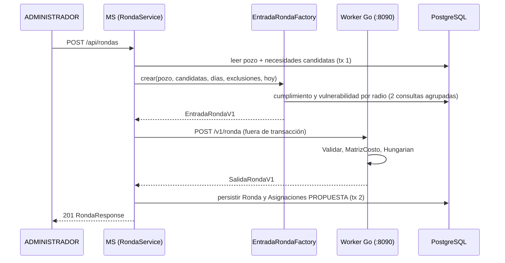

# Worker de asignación: cómo se resuelve una ronda

Explicación del servicio `go_algorithms_worker/` y de su integración con el microservicio (MS). Relevado
sobre la rama `docs/worker-asignacion`. Las rutas con número de línea (`path:línea`) remiten al código
vigente; los valores por defecto son los de `internal/assign/scoring.go`.

## 1. Resumen

Una **ronda** reparte las donaciones del fondo común (modalidad `FONDO_COMUN`, estado `OFRECIDA`, sin
necesidad asignada; `RondaService.java:216-217`) entre las necesidades abiertas de las organizaciones.
El reparto se resuelve como un problema de asignación óptima, no como una elección independiente por
donación.

| Aspecto | Situación |
|---|---|
| Quién lo dispara | Un `ADMINISTRADOR` con `POST /api/rondas` (`RondaController.java:36-43`). Existe además una ronda automática opcional, apagada salvo `app.rondas.auto.enabled=true` (`RondaAutomaticaJob.java:24`). |
| Dónde corre el algoritmo | Worker en Go, proceso `serve` en el puerto `:8090`, sin puerto publicado al host: solo el MS lo alcanza por la red de compose (`go_algorithms_worker/README.md`, sección Commands). |
| Cómo se llama | HTTP `POST /v1/ronda`, contrato versionado en `go_algorithms_worker/contract/ronda-v1.md`. |
| Si el worker está caído | El MS arranca igual; solo la ronda responde `503 WORKER_NO_DISPONIBLE` (`RondaService.java:135-139`) y se registra una ronda `FALLIDA` (`RondaService.java:270-285`). |
| Qué guarda el worker | Nada: es un solucionador sin estado más un servicio geométrico (`POST /v1/radio`). |

El MS dueño de los datos calcula las entradas (déficit, cumplimiento, urgencia); el worker las normaliza,
puntúa cada par donación-necesidad y resuelve la asignación global.

## 2. Flujo de punta a punta



Pasos, con su ubicación:

| # | Paso | Código |
|---|---|---|
| 1 | Se toma un `ReentrantLock`; si ya hay una ronda en curso responde `409 RONDA_EN_CURSO`. | `RondaService.java:115-117` |
| 2 | Lectura del pozo y de las necesidades candidatas (`ABIERTA` o `EN_PROGRESO`) con sus filtros de elegibilidad. | `RondaService.java:62`, `:215-240`, `:249-267` |
| 3 | `EntradaRondaFactory.crear` arma `EntradaRondaV1` dentro de la misma transacción de lectura. | `RondaService.java:123-129`, `EntradaRondaFactory.java:34-53` |
| 4 | Llamada HTTP al worker fuera de toda transacción (conexión 2 s, lectura 30 s). | `HttpAsignadorClient.java:23-24` |
| 5 | El worker decodifica, valida, resuelve parámetros, mapea a tipos internos y llama a `assign.Ronda`. | `internal/api/handler.go:55-95` |
| 6 | `assign.Ronda` construye la matriz de costos, agrega columnas de descarte y ejecuta el algoritmo húngaro. | `internal/assign/ronda.go:57-99` |
| 7 | El MS persiste la `Ronda` y una `Asignacion` en estado `PROPUESTA` por cada par, con el desglose. | `RondaService.java:287-342`, `:344-366` |

Al persistir, una donación que dejó de estar `OFRECIDA` o ya tiene necesidad, o una necesidad que ya no
está `ABIERTA`/`EN_PROGRESO`, se cuenta como `descartadas` y no se asigna (`RondaService.java:312-322`).

## 3. Por qué es un problema de asignación

- Una donación es **indivisible**: va entera a una sola necesidad.
- Una necesidad recibe **como máximo una** donación por ronda.
- El candidato es la **necesidad**, no la organización: así una organización con dos necesidades
  abiertas puede recibir dos donaciones, y una organización bien puntuada no gana todas las donaciones
  (`internal/assign/scoring.go:37-44`).

Si una necesidad pudiera absorber cualquier cantidad de donaciones, cada donación elegiría su mejor
candidata y nada estaría acoplado. Como una necesidad tomada por una donación queda negada para las
demás, **el óptimo de la ronda no es la suma de los óptimos locales** (`internal/assign/ronda.go:41-48`).
La ronda se resuelve entera: se maximiza el puntaje total (`Resultado.ScoreTotal`,
`internal/assign/ronda.go:36-38`).

La prueba `TestRondaSuperaAlArgmaxIndependiente` (`internal/assign/ronda_test.go:74`) fija este
comportamiento.

## 4. El puntaje

Cada par factible recibe un puntaje en `[0, 1]` (`internal/assign/scoring.go:261-296`):

```
score = wD·deficit + wU·urgencia + wP·proximidad + wE·espera + wC·cumplimiento
```

Los pesos se normalizan dividiéndolos por su suma (`Pesos.Normalizados`, `scoring.go:115-127`), de modo
que una solicitud puede sobrescribirlos en cualquier escala.

### 4.1 Términos y normalización

| Término | Peso por defecto | Normalización | Fuente del dato |
|---|---|---|---|
| `deficit` | 0,30 | `min(deficit, deficitMaximo) / deficitMaximo` (`scoring.go:282`) | MS (sección 7) |
| `urgencia` | 0,25 | recorte a `[0, 1]` (`scoring.go:283`) | MS: `UrgenciaCalculator` |
| `proximidad` | 0,17 | `exp(-km / distanciaMediaKm)` (`scoring.go:281`) | distancia de Haversine donación-organización (`scoring.go:194-201`) |
| `espera` | 0,13 | `min(diasDesdeUltimaDonacion / esperaMaximaDias, 1)` (`scoring.go:284`) | MS |
| `cumplimiento` | 0,15 | tasa suavizada, ya en `[0, 1]` (`scoring.go:285`) | MS + suavizado del worker (4.2) |

Los pesos por defecto suman 1 (`scoring.go:141-152`). Cada término se lleva a `[0, 1]` antes de
ponderar porque kilómetros, razones y días viven en escalas distintas (`scoring.go:154-157`).

- **Proximidad**: decaimiento exponencial. Con `distanciaMediaKm = 8`, una candidata a 8 km puntúa
  cerca de 0,37 (`scoring.go:159-161`). Nunca llega a cero, por lo que una candidata lejana con alto
  déficit todavía puede ganar (`scoring.go:277-279`).
- **Espera**: término contra la inanición. Crece con los días desde la última donación de la
  organización y satura en `esperaMaximaDias` (90). El MS cuenta también las donaciones directas, para
  que una organización con muchos donantes directos no parezca postergada
  (`internal/assign/scoring.go:64-72`; el MS usa todas las donaciones salvo `CANCELADA` y `RECHAZADA`,
  `RondaService.java:63`, `:228`). Una organización sin historial recibe 90 días, es decir, espera
  máxima (`RondaService.java:230`).
- **Urgencia**: `max(base(prioridad), vencimiento)`. Base `URGENTE` = 1,0, `MEDIA` = 0,6, `NORMAL` = 0,3;
  el término de vencimiento sube linealmente en los últimos 30 días hasta 1,0
  (`UrgenciaCalculator.java:13-16`, `:33-40`).
- El desglose de los cinco términos normalizados se devuelve por asignación (sección 10).

### 4.2 Cumplimiento: prior y pseudo-observaciones

El MS cuenta por organización las donaciones `ENTREGADA` (entregadas) y `RECHAZADA` (fallidas); excluye
`CANCELADA` y las no terminales (`CumplimientoCalculator.java:13-25`). Una organización sin historial
resuelto no envía el campo (`EntradaRondaFactory.java:90-92`).

El worker suaviza hacia un prior (`internal/assign/cumplimiento.go`):

```
tasa = (E + m·p0) / (E + F + m)          m = 5 pseudo-observaciones (cumplimiento.go:6, :53)
p0   = ΣE / Σ(E + F) sobre los candidatos con historial; 0,5 si nadie tiene (cumplimiento.go:20-37)
```

- `p0` es el cociente global de entregadas sobre resueltas de los candidatos de esa ronda, no un
  promedio de tasas individuales. Puede fijarse con `parametros.cumplimientoPrior` (`cumplimiento.go:21-23`).
- Sin historial (`E = F = 0`) la tasa colapsa a `p0` (`cumplimiento.go:39-47`): una organización nueva
  no puntúa 0 ni 1, sino el promedio de la ronda.
- Es un término blando: nunca excluye a una organización.

### 4.3 Pares infeasibles

Un par donación-necesidad es infeasible, con costo `Inf`, si se cumple cualquiera de estas condiciones
(`scoring.go:262-275`, `:309-325`):

| Filtro | Regla | Código |
|---|---|---|
| Organización excluida | La organización ya rechazó esa donación (devolución al fondo). | `scoring.go:262`, `:298-307` |
| Categoría pedida | La categoría de la donación no está en `categoriasAceptadas` de la necesidad; lista vacía acepta cualquiera. | `scoring.go:203-224` |
| Categoría por acreditación | Idem con `categoriasPermitidas`, que el MS completa según el nivel de acreditación. | `scoring.go:78-85`, `EntradaRondaFactory.java:87-88` |
| Artículos | Si ambos lados declaran artículos, los conjuntos deben intersectarse; si alguno está vacío, el filtro no actúa. | `scoring.go:226-245` |
| Distancia máxima | `km > distanciaMaximaKm` (30 por defecto); `0` desactiva el corte. | `scoring.go:272-275` |

Antes de llegar al worker, el MS descarta las necesidades no elegibles: sin artículos, vencidas, de
organizaciones sin nivel o en `N0`, sin referente o sin coordenadas (`RondaService.java:249-267`).

Las categorías y los filtros son duros, no penalizaciones: un par infeasible nunca se asigna.

## 5. Algoritmo húngaro

`assign.Hungarian` (`internal/assign/hungarian.go:25-118`) resuelve la asignación lineal rectangular con
la variante de Jonker-Volgenant de Kuhn-Munkres (camino aumentante más corto con potenciales de fila y
columna, `hungarian.go:40-43`).

- **Minimiza costos.** El puntaje se niega: `costo = -puntaje` (`scoring.go:322`), de modo que minimizar
  el costo total equivale a maximizar el puntaje total (`hungarian.go:23-24`).
- **Complejidad.** `O(filas² × columnas)` (`hungarian.go:14-16`). Con `n` donaciones y `m` candidatas, las
  filas son `n` y las columnas `m + n` (sección 6).
- **Cota de tamaño.** El contrato admite hasta 500 donaciones y 500 candidatas por solicitud
  (`internal/contrato/ronda_v1.go:19-22`).
- **Precondición.** Exige al menos tantas columnas como filas; en otro caso entra en pánico
  (`hungarian.go:31-33`). Las columnas de descarte la garantizan.
- **Infeasible.** `Inf = MaxFloat64/4`: lo bastante grande para dominar cualquier costo factible y finito
  para que los potenciales sigan definidos (`hungarian.go:9-12`).
- **Verificación.** `hungarian_test.go` compara 200 matrices aleatorias contra una enumeración exhaustiva
  (`internal/assign/hungarian_test.go:39`, `:52`).

## 6. Columnas dummy (descarte)

`matrizConDescarte` (`internal/assign/ronda.go:101-124`) extiende la matriz con **una columna dummy por
donación**:

- En la fila de su propia donación, el costo es `costoDescarte`.
- En las filas de las otras donaciones, el costo es `Inf`.

```
costoDescarte(d) = PenalizacionNoAsignar × min(diasEnFondo / esperaMaximaDias, 1)     (ronda.go:127-133)
```

Se devuelve 0 si `PenalizacionNoAsignar` es 0 o `esperaMaximaDias <= 0` (`ronda.go:128-130`).

Motivos:

1. **El húngaro necesita columnas ≥ filas.** Con las columnas dummy, `m + n >= n` siempre
   (`ronda.go:102-105`); la ronda es factible aunque haya más donaciones que necesidades.
2. **Cada donación tiene su propia opción "quedar sin asignar".** Al costar `Inf` en las demás filas,
   ninguna otra donación puede ocupar esa salida (`ronda.go:103-105`).
3. **Bajo contención gana la donación más antigua.** Dejar sin asignar a una donación vieja cuesta más;
   el solucionador prefiere asignar a la que más esperó (`ronda.go:50-53`).

Una donación emparejada con su columna dummy, con un par infeasible o con un puntaje que no es positivo
(`costo[i][j] >= 0`) vuelve en `sinAsignar` (`ronda.go:74-78`).

### 6.1 Ejemplo mínimo

Dos donaciones, una necesidad `N`. Valores ilustrativos de puntaje (no salen de una corrida real);
`PenalizacionNoAsignar = 0,10` y `esperaMaximaDias = 90`.

| Donación | `diasEnFondo` | Puntaje contra `N` | `costoDescarte` |
|---|---|---|---|
| A | 90 | 0,60 | 0,10 × min(90/90, 1) = 0,10 |
| B | 0 | 0,62 | 0,10 × min(0/90, 1) = 0 |

Matriz de costos (columnas: `N`, dummy de A, dummy de B):

| | `N` | dummy A | dummy B |
|---|---|---|---|
| fila A | −0,60 | 0,10 | Inf |
| fila B | −0,62 | Inf | 0 |

Combinaciones posibles, con costo total:

| Asignación | Costo total |
|---|---|
| A→`N`, B→dummy B | −0,60 + 0 = **−0,60** |
| B→`N`, A→dummy A | −0,62 + 0,10 = −0,52 |

Gana A→`N` (costo mínimo): aunque B puntúa más contra `N`, A espera hace 90 días y perderla cuesta 0,10.
B vuelve en `sinAsignar`. Con `PenalizacionNoAsignar = 0` los dos descartes cuestan 0 y gana B→`N` (−0,62).

### 6.2 Penalización cero

Con `PenalizacionNoAsignar = 0` todas las columnas dummy cuestan 0 sin importar la espera, lo que
reproduce el solucionador previo a la penalización. La propiedad está fijada por
`TestPenalizacionCeroReproduceRondaOriginal` (`internal/assign/ronda_test.go:244`); el caso contrario, por
`TestPenalizacionFavoreceALaDonacionMasVieja` (`ronda_test.go:309`).

## 7. Déficit con datos vivos

El término `deficit` mide cuán desatendido está el radio censal de la organización respecto de la
mediana. Históricamente el worker lo resolvía con CSV incluidos en su imagen; el cambio
`rondas-datos-vivos` movió el cálculo al MS, que es dueño de los datos actuales
(`openspec/changes/rondas-datos-vivos/proposal.md`, sección Intent; `design.md`, sección Technical
Approach).

### 7.1 Precedencia en el worker

`Resolvedor.Resolver` (`internal/geo/deficit.go:111-127`) aplica, en orden:

| Prioridad | Fuente | Condición |
|---|---|---|
| 1 | `PROVISTO` | La solicitud trae `deficit` (incluido `0.0`); siempre gana. |
| 2 | `RADIO` | Hay `codigoRadio` conocido con déficit positivo en los datos cargados. |
| 3 | `CERCANO` | Sin radio utilizable, pero un punto ReNaCoM preciso dentro de `radioResolucionKm` (1,0 km por defecto) tiene déficit positivo. |
| 4 | `NEUTRAL` | Ninguna de las anteriores: déficit 1,0 (la mediana), sin distorsión. |

El proceso `serve` de producción no carga CSV (`go_algorithms_worker/main.go:173-177`): crea un
resolvedor vacío, por lo que en la práctica solo se dan `PROVISTO` y `NEUTRAL`. `RADIO` y `CERCANO` quedan
disponibles solo si se arranca con `--data` (experimentos locales y subcomandos `metrics`/`assign`).

### 7.2 Cálculo en el MS

`VulnerabilidadCalculator` (`jar_hornero_ms/.../asignacion/VulnerabilidadCalculator.java:16-26`, `:61-73`)
calcula, por radio:

```
hpc    = habitantes / comedores
mediana = mediana de hpc sobre los radios con comedores y población     (percentile_cont(0.5))
v      = hpc / mediana × (1 + necesidades / comedores)
```

| Elemento | Definición | Código |
|---|---|---|
| Comedores | Organizaciones `APROBADA` o `SIN_RECLAMAR`, con latitud, longitud y `codigo_radio`. | `VulnerabilidadCalculator.java:32-33`, `PoblacionRadioRepository.java:36-37` |
| Necesidades abiertas | `ABIERTA` o `EN_PROGRESO`, sin `fecha_vencimiento` vencida. | `VulnerabilidadCalculator.java:34-35`, `PoblacionRadioRepository.java:32-33` |
| Población | Tabla `poblacion_radio (codigo_radio, habitantes)`, creada por `scripts/sql/V011__poblacion_radio.sql` y cargada con `make importar-poblacion`. | `Makefile:107-108` |
| Mediana | Valor central, o media de los dos centrales si el conteo es par. | `VulnerabilidadCalculator.java:79-85` |
| Radios excluidos | Los de población 0 o sin comedores no entran en la mediana ni reciben valor. | `VulnerabilidadCalculator.java:60-65` |

El factor `(1 + necesidades/comedores)` hace que un radio sin necesidades abiertas valga exactamente su
razón de cobertura (`go_algorithms_worker/README.md`, sección Vulnerability override). Las cuentas salen
de **una** consulta agrupada por ronda (`PoblacionRadioRepository.java:23-45`); la mediana y la fórmula
se calculan en Java para poder probarlas sin base de datos (`design.md`, AD-4).

### 7.3 Tope y caída a NEUTRAL

- El valor se acota con `deficitMaximo` (3 por defecto): `min(v, 3) / 3` (`scoring.go:282`). Un radio
  extremo no aplana a los demás (`scoring.go:166-168`).
- `EntradaRondaFactory` envía `codigoRadio` siempre que existe y `deficit` solo si el mapa tiene un valor
  para ese radio (`EntradaRondaFactory.java:79-82`).
- Sin radio, o con radio sin población (o sin comedores), no se envía `deficit` y el worker responde
  `NEUTRAL` 1,0, que queda registrado en `deficitFuente`. Si la tabla está vacía, el MS emite una
  advertencia pidiendo `make importar-poblacion` (`VulnerabilidadCalculator.java:53-56`).

Con `NEUTRAL`, el término vale `1 / 3` con los parámetros por defecto: una organización sin dato no es
favorecida ni penalizada respecto de la mediana.

## 8. Radio censal de cada organización

Para que una organización cuente como comedor y reciba un déficit propio, el MS necesita su
`codigo_radio` (Censo 2022). No lleva geometría: la consulta al worker.

**Worker.** `POST /v1/radio` con `{"latitud","longitud"}` devuelve `{"codigoRadio"}`
(`internal/api/handler.go:103-143`). Códigos de error: `400 ENTRADA_INVALIDA`, `404 RADIO_NO_ENCONTRADO`,
`405`, `413 CUERPO_DEMASIADO_GRANDE` (cuerpo mayor a 4 KiB, `handler.go:22-23`) y
`503 RADIOS_NO_DISPONIBLES` si el índice no está cargado (`handler.go:130-133`).

- **Dato**: `data/radios-2022.ndjson.gz`, NDJSON comprimido con un radio por línea; se carga con
  `serve --radios` (`main.go:186-214`). Si falta o no se lee, solo se registra una advertencia: la ronda no
  depende de este activo.
- **Búsqueda** (`internal/radios/radios.go:143-182`): grilla uniforme de 0,05 grados sobre las cajas
  contenedoras (`radios.go:18-19`); punto en polígono por regla par-impar sobre todos los anillos, de modo
  que los huecos quedan excluidos (`radios.go:184-185`); si el punto cae sobre un borde compartido, gana
  el código menor; si cae en un hueco de la simplificación, se toma el borde más cercano dentro de 25 m
  (`radios.go:23-25`, `:161-181`).

**MS.**

| Cuándo | Qué hace | Código |
|---|---|---|
| Alta de organización | Resuelve el radio con las coordenadas; si faltan o el worker falla, queda `null`. | `OrganizacionService.java:87`, `:389-394` |
| Edición | Si las coordenadas cambian, vuelve a resolver (o borra) el radio para no conservar el del lugar anterior. | `OrganizacionService.java:349-353` |
| Cada hora (minuto 15) | `RadioCensalBackfillJob` toma hasta 500 organizaciones con coordenadas y sin radio y lo completa. Nunca sobrescribe un radio existente. | `RadioCensalBackfillJob.java:19-22`, `:43`, `:50`, `:92-96` |

La resolución es de mejor esfuerzo: `HttpRadioCensalClient` usa tiempos de espera cortos (conexión 1 s,
lectura 2 s) y ante cualquier fallo devuelve vacío sin lanzar excepción
(`HttpRadioCensalClient.java:15-19`, `:24-25`, `:49-70`). Las organizaciones fuera de todo radio se
reintentan en cada corrida del backfill (`RadioCensalBackfillJob.java:26-27`). Mientras no tengan radio,
sus candidatas puntúan `NEUTRAL`.

## 9. Validaciones de entrada

`EntradaRondaV1.Validar` (`internal/contrato/ronda_v1.go:119-164`) rechaza con `400` y código
`ENTRADA_INVALIDA` (la versión no soportada usa `VERSION_NO_SOPORTADA`, también `400`):

| Regla | Código |
|---|---|
| `version` distinta de 1 (`VERSION_NO_SOPORTADA`) | `ronda_v1.go:124-126` |
| Más de 500 donaciones o más de 500 candidatas | `ronda_v1.go:127-132` |
| Coordenadas no finitas o fuera de `[-90, 90]` / `[-180, 180]` | `ronda_v1.go:135`, `:149`, `:244-249` |
| `diasEnFondo` negativo | `ronda_v1.go:138-140` |
| Id de donación repetido; `necesidadId` repetido | `ronda_v1.go:141-144`, `:155-157` |
| `urgencia` fuera de `[0, 1]` | `ronda_v1.go:170-171` |
| `deficit` negativo o no finito | `ronda_v1.go:172-173` |
| `diasDesdeUltimaDonacion` negativo | `ronda_v1.go:174-175` |
| `cumplimiento` con `entregadas` o `fallidas` negativas | `ronda_v1.go:176-177` |
| Pesos no finitos o negativos, o todos en 0 | `ronda_v1.go:184-200` |
| `distanciaMediaKm`, `deficitMaximo`, `cumplimientoPseudoObs`, `esperaMaximaDias` menores o iguales a 0 (son denominadores) | `ronda_v1.go:209-213`, `:222-234` |
| `distanciaMaximaKm`, `penalizacionNoAsignar`, `radioResolucionKm` negativos | `ronda_v1.go:215-220`, `:223-226` |
| `cumplimientoPrior` fuera de `[0, 1]` | `ronda_v1.go:236-238` |

Además: JSON mal formado responde `400 ENTRADA_INVALIDA`, y un cuerpo mayor a 1 MiB responde
`413 CUERPO_DEMASIADO_GRANDE` (`handler.go:18-20`, `:64-71`). Las categorías son texto libre: un valor
desconocido no se rechaza, simplemente no coincide con ninguna candidata que no lo liste
(`ronda_v1.go:119-122`).

## 10. Resultado y explicabilidad

`SalidaRondaV1` (`internal/contrato/ronda_v1.go:365-386`):

| Campo | Contenido |
|---|---|
| `asignaciones[]` | Pares elegidos, ordenados por puntaje descendente (`ronda.go:95-97`). |
| `sinAsignar` | Ids de las donaciones sin par; siempre presente, `[]` si no hay (`ronda_v1.go:407-410`). |
| `scoreTotal` | Suma de los puntajes de la asignación; es lo que maximiza el húngaro. |
| `pesos`, `parametros` | Valores efectivamente aplicados (defaults más sobrescrituras), para auditoría. |

Cada asignación incluye:

- **`score`** y **`distanciaKm`**.
- **`desglose`**: los cinco términos normalizados en `[0, 1]` antes de ponderar (`scoring.go:129-139`). El
  MS lo persiste como `terminoDeficit`, `terminoUrgencia`, etc. (`RondaService.java:355-362`).
- **`costoOportunidad`**: el mejor puntaje que esa donación habría tenido sola, menos el que obtuvo
  (`ronda.go:16-21`, `:89`, `:135-145`). Cero significa que la ronda coincide con la elección voraz; un
  valor positivo es lo que la ronda le pidió ceder a esa donación. El húngaro es óptimo globalmente pero
  una asignación individual puede puntuar menos que otra opción libre, así que "tuvo el puntaje más alto"
  no siempre es la razón; este campo es la cifra para explicarlo (`go_algorithms_worker/README.md`,
  sección Explaining a result).
- **`deficitFuente`** (`PROVISTO`, `RADIO`, `CERCANO`, `NEUTRAL`) y **`codigoRadio`**
  (`ronda_v1.go:384-385`, `:403-404`); el MS los guarda en la asignación (`RondaService.java:363-364`).

El criterio es determinista y sin azar a propósito: en una plataforma de donaciones, poder explicar por
qué una donación fue a un destino importa más que exprimir el último punto de optimalidad
(`go_algorithms_worker/README.md`, sección The assignment).

## 11. Parámetros configurables

Una solicitud puede sobrescribir `pesos` (los cinco a la vez) y cualquier campo de `parametros`; lo que
no se envía toma el valor por defecto (`ronda_v1.go:322-363`).

### 11.1 Pesos (`assign.PesosPorDefecto`, `scoring.go:146-152`)

| Campo | Defecto | Significado |
|---|---|---|
| `deficit` | 0,30 | Peso de la cobertura desatendida del radio. |
| `urgencia` | 0,25 | Peso de la prioridad y cercanía del vencimiento. |
| `proximidad` | 0,17 | Peso de la cercanía física donación-organización. |
| `espera` | 0,13 | Peso del tiempo desde la última donación de la organización. |
| `cumplimiento` | 0,15 | Peso de la tasa de entregas suavizada. |

### 11.2 Parámetros (`assign.ParametrosPorDefecto`, `scoring.go:182-189`)

| Campo | Defecto | Restricción | Significado |
|---|---|---|---|
| `distanciaMediaKm` | 8 | `> 0` | Constante de decaimiento de la proximidad. |
| `distanciaMaximaKm` | 30 | `>= 0` | Distancia sobre la cual el par es infeasible; `0` desactiva el corte. |
| `esperaMaximaDias` | 90 | `> 0` | Días en que satura `espera` y el costo de descarte. |
| `deficitMaximo` | 3 | `> 0` | Tope del déficit antes de normalizar. |
| `penalizacionNoAsignar` | 0,10 | `>= 0` | Costo de la columna dummy con espera completa; `0` reproduce el solucionador original. |
| `cumplimientoPseudoObs` | 5 | `> 0` | Intensidad `m` del suavizado del cumplimiento. |
| `cumplimientoPrior` | calculado | `[0, 1]` | Reemplaza el `p0` que el worker calcularía; no se devuelve en `parametros`. |
| `radioResolucionKm` | 1,0 | `>= 0` | Radio de búsqueda de `CERCANO`; no pertenece a `assign.Parametros` (`ronda_v1.go:330-335`). |

`radioResolucionKm` se valida (`ronda_v1.go:226`), pero el handler descarta su valor (`handler.go:84`): con `serve` sin datos no tiene efecto, porque `CERCANO` no se usa.

## 12. Limitaciones conocidas

| # | Limitación | Evidencia |
|---|---|---|
| 1 | **Ronda síncrona.** El MS espera la respuesta del worker con timeout de lectura de 30 s; una ronda grande puede superarlo. La mitigación prevista es responder `202` y ejecutar en segundo plano. | `HttpAsignadorClient.java:24`; `docs/escalabilidad.md`, sección 3, fila 5 |
| 2 | **Lock en memoria.** El `ReentrantLock` solo excluye dentro de la misma JVM; con dos instancias del MS podrían correr dos rondas a la vez. Se propone `pg_advisory_xact_lock`. | `RondaService.java:78`, `:115`; `docs/escalabilidad.md`, sección 5 |
| 3 | **N+1 en la lectura.** Una consulta por organización candidata y otra por donación del pozo. | `RondaService.java:225-237`; `docs/escalabilidad.md`, sección 3, fila 4 |
| 4 | **Tope de 500 × 500.** Una solicitud con más donaciones o candidatas se rechaza con `ENTRADA_INVALIDA`; el MS no divide la ronda. | `ronda_v1.go:19-22`, `:127-132` |
| 5 | **Costo cúbico del solucionador.** `O(n² × (m + n))` por ronda; acotado por la limitación 4. | `hungarian.go:14-16` |
| 6 | **Puntaje nulo = sin asignar.** Un par con puntaje 0 exacto se trata como no asignado, porque la condición es `costo >= 0`. | `ronda.go:74` |
| 7 | **Radios sin resolver puntúan NEUTRAL.** Una organización sin `codigo_radio`, o en un radio sin población, no recibe déficit propio; el backfill puede tardar hasta una hora. | `EntradaRondaFactory.java:79-82`; `RadioCensalBackfillJob.java:19-22` |
| 8 | **`CERCANO` y `RADIO` no se usan en producción.** `serve` arranca sin datos, así que el déficit depende de que el MS lo calcule. | `main.go:173-177` |
| 9 | **Asignaciones obsoletas.** Entre la lectura y la escritura una donación o necesidad puede cambiar; esos pares se descartan y no se reasignan en la misma ronda. | `RondaService.java:312-322` |
| 10 | **`asistentes_declarados` no entra en la fórmula del déficit.** | `openspec/changes/rondas-datos-vivos/proposal.md`, sección In Scope |
